# custom-skate

Two custom hockey skates, one for ice and one for roller, on boots made from a 3D scan of the
skater's feet. The roller skate rides an aluminium chassis that rocks like Marsblade's but weighs
the same as a premium one-piece chassis; boot and chassis are designed together, so the boot's sole
is the part that rocks. The ice skate takes a dynamic (rocking) blade holder. Modelled with
[CortenForge](https://crates.io/crates/cortenforge). The chassis came first, so most of this page
is about it; the boot plan is in `docs/PLAN.md` (track B). The project has since grown into the
rest of the gear: shin pads and a girdle fitted to the same stand-in body, with gloves, elbow
pads and a helmet (a design study, not for wear) under way ([The gear](#the-gear), track D).

**[Open the skates in 3D](https://youngmoolahbaby.github.io/custom-skate/)**: ice or roller, open or
V throat, two colourways or your own, taken apart or cut through. Built on the stand-in foot;
published with `tools/publish_pages.sh` after a build.

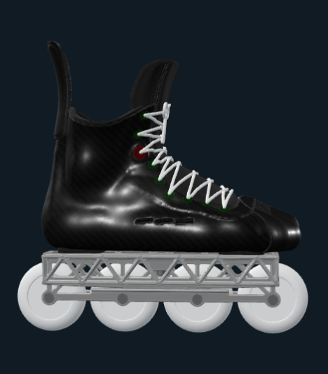

*The roller skate on the rocker chassis, four 72 mm wheels; the boot is grown from a 3D foot
scan (a stand-in foot for now). Jon's colourway, made in the viewer's Custom mode.*

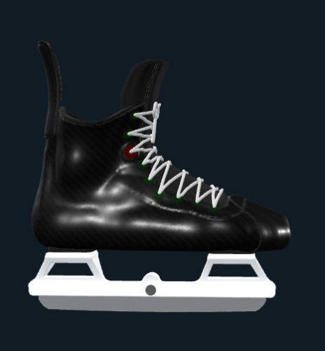

*The ice skate: the same boot on a first look at our own rocking holder, the runner rocking
against an insert inside it (our own runner and insert; nothing proprietary).*

A Marsblade-style frame is split in two. A rounded upper chassis carries the boot and rocks
heel-to-toe on a flat lower chassis that carries the wheels, held together by a sprung coupling.
The skater's foot can pitch the way it does on an ice blade while all four wheels stay on the
floor. The catch is weight. The two-piece frame is far heavier:

| Chassis | Weight | Source |
|---|---|---|
| Hi-Lo Kryptonium, 7000-series one-piece | 175 g (S/M), 184 g (L), with axles and spacers | Coast Hockey Shop |
| Rink Rat Rinkster Sniper Hi-Lo, 7075-T6 one-piece | ~170 g (MD) | Inline Warehouse |
| Konixx Bolt Hi-Lo, one-piece | 173 g (MD) | Ice Warehouse |
| Marsblade R1 (glass-fibre nylon upper, Al-Mg lower) | 282 g without wheels and bearings / 302 g (MD) | Hockey World Blog / Inline Warehouse |
| Marsblade O1 (resin) | 376 g (MD) | Inline Warehouse |

**The goal is a rocking chassis in the 170-185 g class: about 110-130 g lighter than the R1.**

## Why rock? The science

1. **The geometry: Daggfeldt & Petré (2025)**, Swedish School of Sport and Health Sciences (GIH),
   *Proc IMechE Part P*, [doi:10.1177/17543371251389073](https://doi.org/10.1177/17543371251389073).
   On ice, the foot can pitch only as far as the blade rolls. Moving the contact point 30 cm on a
   2.7 m (9 ft) blade gives about 6.4°. A smaller blade radius would give more pitch, but it
   shortens the contact with the ice and raises plowing resistance. A rocker between the holder and
   the blade separates the two: pitch is set by the rocker radius, glide by the blade radius.
   Their equations are in `src/pitch.rs`, checked against the paper's own numbers.
2. **The Canadian study: Lockwood, Dunne, Hsu (Brock University) and Ellingson (George Brown
   College), 2023**, "Effect of a Fixed versus Dynamic Pitch on Hockey-Specific Skating Skills"
   ([poster PDF](https://images.marsblade.com/uploads/2023/12/poster_spin-2023_fixed-versus-dynamic.pdf)).
   11 collegiate players skated on a treadmill and on ice, wearing IMU motion capture and pressure
   insoles. On Marsblade's i2 dynamic holder, the in-skate forces were lower at the same speed:
   forward skating on the treadmill had 5% lower mean force, 8% lower peak force and 8% lower
   impulse. C-cuts and backward skating had longer strides and larger joint angles.
3. **The sprint study: Psilander, Arndt & Petré (2025)**, *Footwear Science*,
   [doi:10.1080/19424280.2025.2563837](https://doi.org/10.1080/19424280.2025.2563837): elite
   players skated backward 1-2% faster on the dynamic holder.

**What this means for roller.** A one-piece roller chassis is a flat, rigid line of wheels. The
foot can pitch only by tipping the whole frame onto its end wheels. A rocker on a flat lower
chassis is the paper's model with a flat "blade" (s → ∞): the foot pitches x / r while every wheel
stays down. From `cargo run --release -- pitch`:

| | deg of foot pitch per cm of weight shift |
|---|---|
| Ice blade, 9 / 11 / 13 ft | 0.209 / 0.171 / 0.145 |
| Roller rocker, 5 / 7.5 / 10 / 15 ft (the R1's inserts span 5-15 ft) | 0.376 / 0.251 / 0.188 / 0.125 |
| One-piece roller chassis | 0 until it tips |

So the R1's rocker range brackets an ice blade's. The rocker gives a roller skate an ice
skate's pitch back.

**Limits of the evidence.** None of these studies tested a roller chassis; all three tested the
i2 ice holder, which uses the same rocker. The Brock / George Brown study is a conference poster
hosted by Marsblade. Its force numbers come from insoles inside the boot, not from the blade on
the ice, and the poster marks none of the force differences as significant. The GIH sprint study
found a gain only in backward skating. Details and numbers are in `docs/RESEARCH.md`.

## Run

```
cargo run --release -- check         # every tool used, against known results (50/50)
cargo run --release -- pitch         # the pitch tables above
cargo run --release -- scan <file>   # measure a foot scan (OBJ, STL, PLY)
cargo run --release -- round1 <scan> # the whole skate on one foot -> out/round1 (STL, PNG)
cargo run --release -- chassis       # the round-2 roller chassis alone: weighed, rocked, checked -> out/chassis
cargo run --release -- boot <scan> [out] [ice|roller] [open|v]   # the hockey boot, every part weighed and drawn
cargo run --release -- leg <scan>    # the stand-in leg: the foot scan joined to MakeHuman's leg
cargo run --release -- pad <scan>    # the shin pads on the leg in the boot (run `boot` first)
cargo run --release -- impact        # puck impacts (sim-soft-explicit) against a spring-mass check
cargo run --release -- body <scan>   # the stand-in body, waist to feet
cargo run --release -- girdle <scan> # the girdle on the body
cargo run --release -- poses <scan>  # the body posed: standing, skating stance, kneeling, crouch
cargo run --release -- cup <scan>    # the shin pad's knee as a cup on the bent knee (run `pad` first)
cargo run --release -- gap <scan>    # the girdle-to-shin-pad gap through the knee's and hip's bend (run `pad`, `cup` first)
cargo run --release -- upper <scan>  # the stand-in body above the waist: arms, hands, head
```

The pad, girdle and gap runs take 8-30 minutes; `PAD_THREADS=2` keeps their memory down.

Builds go to `D:/cargo-target/custom-skate` (`.cargo/config.toml`, local only). The first
release build takes about 3 minutes.

## Round 1: the whole skate on an example foot

Every stage, end to end, on a stand-in foot (a CC0 research scan): the foot, a last with a toe
box, the boot shell and liner, a fit map, a roller chassis with the rocker under the sole, and an
ice holder placeholder. Round-1 quality: a first layout, not a design. The picture at the top of
this page is its roller skate.

- Boot shell 277 g printed in PA 12 (425 g in carbon/epoxy), liner 44 g.
- Fit: snug (~1 mm) at the heel, midfoot, instep and ball; room only round the toes.
- Roller chassis, first layout: 281 g, the same as a Marsblade R1. The lower frame is 208 g of
  it, so that is where the ~100 g to the one-piece class (170-184 g) has to come from.

More pictures and the numbers: `docs/round1/`, and `docs/PLAN.md` (Round 1).

## Round 2: the chassis to weight

Following the loads by hand changed the layout. Vertical loads hardly size a frame. What does is
**roll**: the sideways push at the wheels acts ~80 mm below the sole, and a rocking joint has to
pass that moment across. Round 1's rocker sat on top of the lower frame, narrow and high, where
it can't. So in round 2 the upper hangs two truss walls outside the lower rails. Each wall's foot
is the rocker arc, and it rolls on a low ledge on the rail. The vertical load alone then holds
the roll up to a sideways / vertical ratio of 0.37, against ~0.19 for round 1.

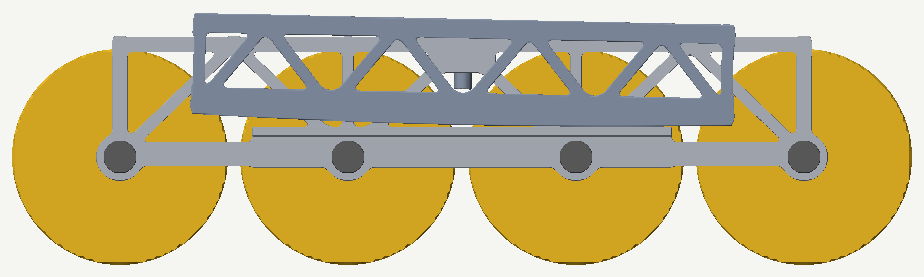

*The round-2 chassis rocked toe-down to the end of its travel (contact 50 mm forward, 1.25° of
foot pitch). Dark: the upper, its truss wall hanging outside the lower rail; its bottom edge is
the rocker arc, rolling on the ledge above the axles. All four wheels stay down.*

- **Step 1: 174 g** with axles, spacers and the coupling, down from round 1's 281 g. All
  vertical-load checks pass by hand formulas (worst at 0.74 of its allowable, for a 100 kg skater
  at 1.5x body weight striding and 3x landing). A one-piece built from the same members weighs
  111 g, so the rocker costs 63 g.
- **Step 2: FEM.** CortenForge's soft-body solver, sim-soft, works as a linear-elastic solver for
  aluminium: within 1% of beam theory once run static and at a small fraction of the load. Its
  reaction readout lets the two-piece frame be solved as two linked models.
- **The sideways push sizes the frame.** At 0.45 of the stride load, the 174 g frame's thin parts
  go past yield. So the sizing is like for like: a one-piece thickened to real weights sets the
  target, under the same loads and the same boot mounts. At 170 g it gives 0.35 mm sideways at
  the axles, peak 208 MPa.
- **By thickening alone, the rocker can't match that at a sensible weight.** The stiffest run is
  0.42 mm at 288 g. At equal stiffness the rocker costs 76 g more than a one-piece at 2 mm
  parts, and 103-127 g as it nears the one-piece's stiffness; that is roughly R1 weight
  (282-302 g). The reason: the upper's walls carry the push up to the boot as plates bending
  out of their own plane, the job a one-piece's rails do, so the lower frame is the extra.
  Bonding the upper to a custom boot's sole makes it ~40% stiffer.
- **Leaning the walls into a V doesn't help overall.** Leaning them so that, from the front,
  they meet at the wheels' contact patch, the push runs along the walls instead of bending them:
  the upper gives 6x less. But a tilted seat only touches at the rolling contact, mid-length, so
  the lower has to carry the push lengthwise to it, and it twists. Best: 1.00 mm at 228 g, no
  better per gram than thickening.
- **Ribbed walls do better, and bonded to the boot's sole they reach one-piece stiffness.** A rib
  on every member of the walls makes each a T-section. Bolted at two mounts that saves 10-20 g
  over thickening, still 81-92 g over a one-piece as stiff. Bonded along a custom boot's sole
  (modelled as rigid, so a best case), it gives 0.37 mm at 223 g and 0.28 mm at 244 g, against
  0.35 mm for the 170 g one-piece: about 60-70 g over a one-piece, and 40-80 g under an R1.
  Next: the custom-boot route with a real sole, or pinned links that pass the push near the
  mounts (`docs/PLAN.md`).

Pictures and numbers: `docs/round2/`, and `docs/PLAN.md` (Round 2).

## The boot: a hockey boot from the scan

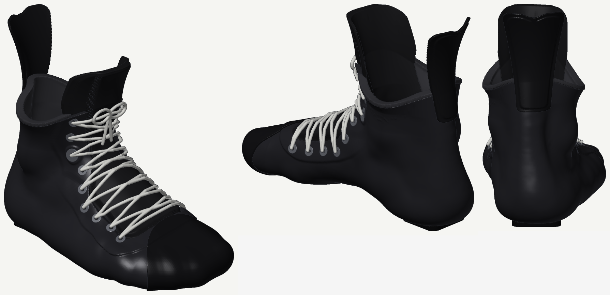

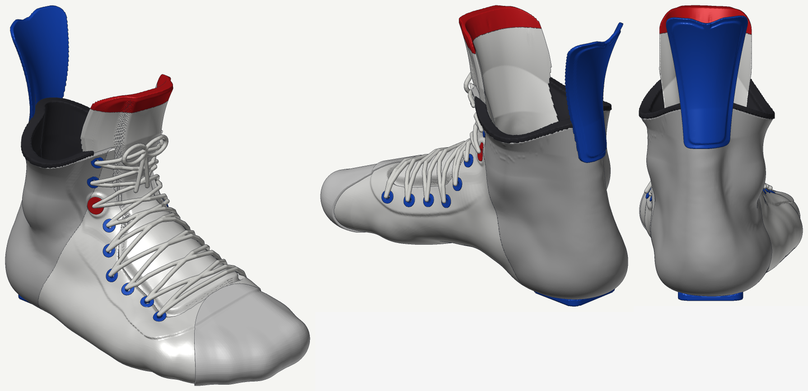

*The ice boot on the stand-in foot, in two editions: all black (carbon shell, black thermoplastic
toe cap, mount pads and tendon guard, black printed tongue, white laces), and an alt in white
fibreglass weave, royal blue, a cement-grey heel panel and red accents, from a sneaker colourway
Jon likes. The roller boot is the same, vented (`docs/boot/roller/`); the V-throat version for
flexible boots is in `docs/boot/v/`.
`cargo run --release -- boot <scan> [out] [ice|roller] [open|v]`.*

- **Tight from heel to toe, open at the top**, as Jon skates. The cuff stops just above the
  outer ankle bone at the sides (40 mm), rising up the shin at the front for the lacing and into
  a tall tendon guard at the back. Above the ankle bones the liner and shell flare out together:
  13 mm of room at the sides, so **the ankle tips about 19° each way** before the leg meets the
  liner; 7 mm in front; a slight press at the back to pitch the leg forward.
- **Two throats** (Jon: "1 for the former, which would be good for shoes/more flexible boots,
  and the new opening ... for stiffer boots"). **Open**, for stiff boots like this one (Jon: a wide
  throat like the CCM Jetspeed FT6 Pro's, the shell still low tolerance round the foot): over
  the forefoot and instep the opening runs half the way from the top of the foot to its widest
  line, measured along the surface the same on both sides, so it sits square on the top of the
  foot; a short vamp. **V**, for shoes and flexible boots: narrow from the toe cap, widening up
  the shin. Either way the eyelets run in mirrored pairs, evenly spaced (~19 mm), splaying into
  a V up the shin for forward flex; a 6° forward lean.
- **A 3D-printed tongue**, as True does: TPU, a solid plate (outer skin, rim, inner skin) round a
  gyroid lattice core that breathes and squashes; thin under the shell's edges, swelling between
  them, its edges rounded and its top flaring forward.
- **The heel lock:** the eyelet pair at the ankle crease, whose lace pulls the heel into its
  pocket, is heavy duty: bigger grommets on a raised boss.
- **Ice sealed, roller vented:** slots through the roller boot's toe cap, lower quarters and
  liner; the ice boot stays sealed against a cold rink and meltwater.
- **Placed from the scan.** The ankle bones set the cuff, the ankle pockets and the pads; the
  line over the top of the foot and up the shin, and cross-sections across it, set the throat,
  the tongue, the eyelets and the laces. The shell's inside follows the foot; its outside is smoothed over the hollows. So the
  same code fits Jon's foot once it's scanned.
- **The sole is two flat mount pads**, heel and forefoot, where the holder or chassis attaches;
  between them the shell's own rounded underside. **The tendon guard is a shield**, narrow where
  it rivets on, flaring at the top, ribbed.
- **377 g (ice), 375 g (roller)** with the open throat (367 / 364 with the V), weighed with the
  shell, toe cap and mount pads in printed nylon (PA 12): shell 204 g, mount pads 15 g, toe cap
  14 g, liner, ankle pads and footbed 39 g, printed tongue 67 g (49 with the V's narrower
  tongue), tendon guard 19 g, eyelets and laces 19 g. The foam, TPU and lace densities are
  assumed.
- **Built on the leg, not just the foot:** the foot scans stop at the ankle, so the boot is built
  on the scan joined to a stand-in leg (MakeHuman's CC0 body set to US Army ANSUR II
  measurements), and its tongue, cuff and tendon guard follow a real shin and calf.
- **Estimates until measured:** the heights of the cuff, tongue and tendon guard, the lean, and
  the eyelet spacing (`docs/MEASURE.md`, B1-B7, on the TF9).
- **Getting it on and off:** a rigid-foot, rigid-shell check (the unloaded foot, each point
  tracked inside, outside, in an opening or in the wall) shows a perfectly rigid foot stays
  trapped in a boot this tight whatever the opening: the toes under the toe cap, the ball
  against the narrower midfoot, the heel against the hollows beside the Achilles. Real feet
  get out because toes bend and tissue squashes; sizing the opening and the heel lock needs the
  fit simulation and printed test shells (`docs/PLAN.md`).
- **Next for the boot:** the fit simulation, panels and character lines, then the holder under it.
  Jon's own scans, puck protection (an air-gapped shield) after. The sole becomes the roller
  chassis's upper, and the ice skate's one-piece holder takes our own runner and rocker insert;
  nothing proprietary.

Pictures, the layer sections and the numbers: `docs/boot/`, and `docs/PLAN.md` (Track B).

## The whole skate

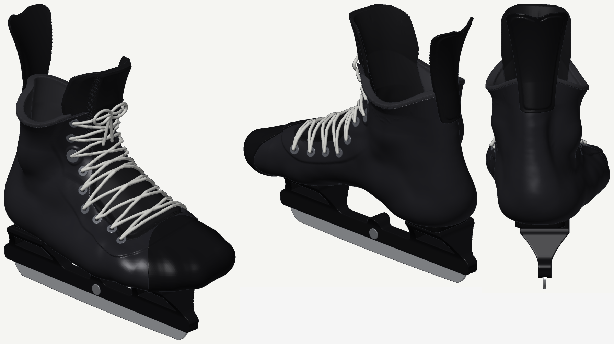

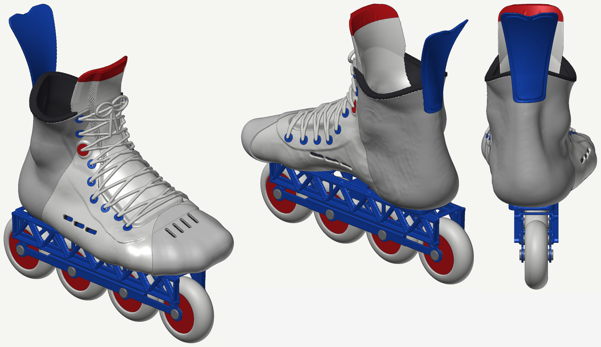

*The boot on what goes under it, both editions and both skates in `docs/skate/`; in the
viewer too, with custom colours for every part.*

- **Roller: the round-2 rocker chassis**, the ribbed upright walls that came out stiffest within
  the fatigue allowable when bonded to the sole (upper 240 mm, 6 panels, 5 mm ribs), centred under
  the boot's mount pads; 4 x 72 mm wheels, the upper rocking on a 7.5 ft arc; the floor 82 mm
  below the sole. **Chassis 241 g** (round 2 weighed it at 244 g by a finer method); **the whole
  skate 616 g without wheels and bearings.**
- **Ice: a first look at the holder, not yet designed** (Track C): two windowed towers under the
  mount pads on a beam, our own steel runner rocking against our own insert in the beam's
  channel, on a pivot pin; nothing proprietary. 254 mm long (Jon's i2 size); the rest are
  estimates: an 11 ft runner on a 23 ft insert (the i2's, as a reference), 16 mm of steel
  showing, the ice 62 mm below the sole. **Holder 108 g in printed nylon, runner 131 g of steel,
  244 g with the insert and pin; the whole skate 621 g.**
- With the V throat: 611 g (ice), 605 g (roller).

## The gear

Jon: "even though this says custom skate, id like to actually do full hockey equipment." Shin
pads and a girdle came first, fitted to one stand-in body: MakeHuman's CC0 body set to the US
Army's ANSUR II medians for men 170-180 cm, joined to the stand-in foot scan. Gloves, elbow pads
and a helmet come next, on the same body.

> **The helmet is a design study.** It is not certified (HECC, CSA or any other standard) and
> has not passed any impact test. Do not wear it for hockey or anything else. A simulation can't
> show that a helmet protects; only drop tests can, and sanctioned play needs a certified
> helmet.

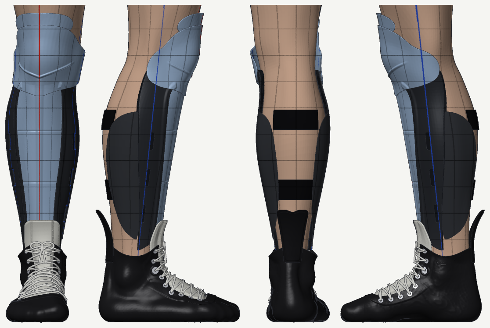

- **Shin pads** fitted to the leg and the boot, so pad and skate read as one piece. Tongue
  under the pad or over it; ice now, roller (a lighter puck, a hotter rink) to follow. A
  modern pad's parts: a tapered front shell, vented side panels, one knee shield, a thigh
  guard, calf wraps, straps. A hard PA 12 shell over a foam liner, **372 g**. It stands 19.6 mm
  off the shin at the front and 9-10 mm at the sides. Stock and undersized pads modelled on the
  same leg stand 27.8 and 23.4 mm off at the front, but with 8 mm of foam to its 14: a like-for-
  like rerun is to come.
- **Puck impacts** (sim-soft-explicit, checked against a spring-mass impact): foam thickness is
  the lever. 14 mm of foam at the front takes a third off the force that reaches the shin
  (12.4 kN against 18.5 with 8 mm, on a rigid shin; the absolute forces are high until the
  shin and the foam's losses are modelled). Through the pad, a cold puck hits 1.5x as hard as a
  warm one.
- **A modern girdle**, compression shorts holding thigh, hip, kidney and tailbone pads: 840 g,
  layers still placeholders.
- **The knee as a cup**, built on the body bent 70° at the knee, the skating stance from
  published motion capture (65° on a skating treadmill, 75° at the peak of an on-ice cut), held
  on by the sock or pants. Two hard shells: a **knee cap**, flex-hinged to the shin shell, and a
  **top** that rests on the thigh with its edge just below the girdle, the cap sliding under it
  (63 mm as the leg straightens, 72 mm out the other way in a deep crouch). The foam under them
  is in a full-length compression suit with the girdle, so it stays on the skin wherever the
  shells slide; it has to go in a washing machine. Straight, the top lies flat on the thigh; bent
  to 135° the shells still overlap, so the knee stays covered. The cost: **113.6 g** of shell,
  51 g more than a straight knee shield and thigh guard (the shin pad ~395 g, plus 34 g of foam
  in the suit).
- **A kneecap for the body.** MakeHuman's body has none, and its knee skin followed the thigh.
  Added as a bone from cadaver and MRI studies: it flexes 0.7 times the knee, runs on a circle
  round it, and its tendon keeps its length.

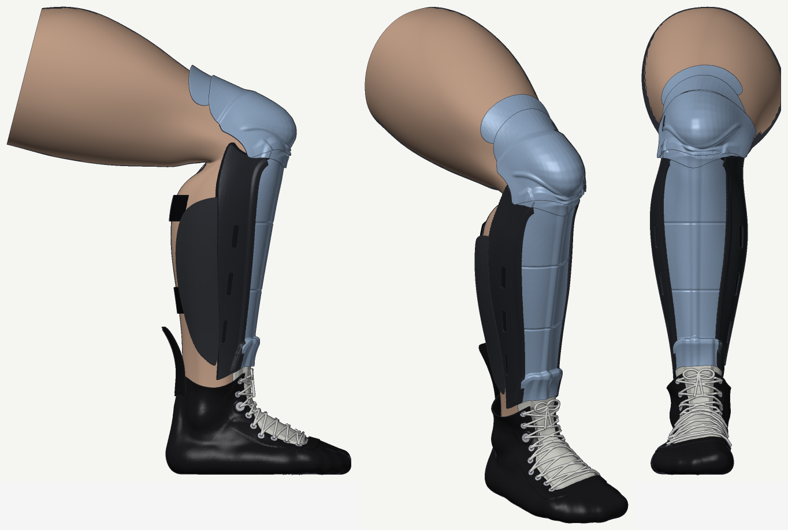

- **Posed** with MakeHuman's skeleton and skin weights: standing, skating stance, kneeling, deep
  crouch. The shin pad's top stays 5-6 mm below the girdle's thigh pad from straight to 30° of
  knee bend, 12 mm at the stance, 12-16 deep. If the belly pushes the thigh pad down the thigh
  with the legs straight (sitting, hip 90°), it reaches the knee cap by 4.4 mm.

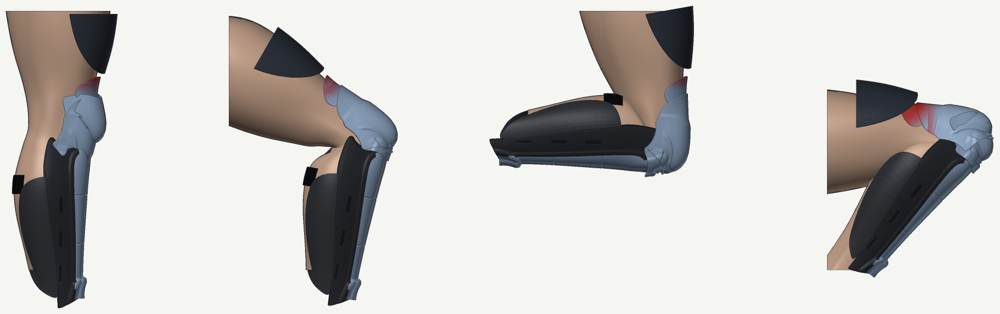

- **The body above the waist**, for the gloves, elbow pads and helmet: MakeHuman's arms, hands
  and head fitted to ANSUR II the same way (arm lengths, wrist, hand length and breadth, head
  length, breadth and height, each measured as the army's handbook describes). The head's girth,
  not fitted, comes out within 1.1% of the median; the hand is 6% thin round the knuckles, so the
  glove's palm wants Jon's own hand. Nothing below the waist moved. The arm bends 90° at the
  elbow and the hand closes on the army's 1¼" test dowel where its men held it, the fingers
  wrapped evenly, then on a senior shaft (Bauer's published 19.3 × 29.8 mm). Jon shoots left: the
  right hand modelled is his top hand.

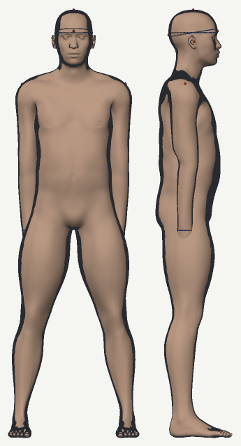

Next: the gloves, shaped round the hand gripping the stick, with elbow pads and the gap between
them; the helmet as a design study; the suit (a washable foam, a slick face for the shells to
slide on); lighter knee shells; how far a girdle and a shin pad shift in play, which sets the
gap; the roller pad. Pictures and numbers: `docs/pad/`, `docs/girdle/`, `docs/body/`,
`docs/upper/`, and `docs/PLAN.md` (Track D).

## Status

Phase 0 (the science, the pitch model, the mass tool checked), round 1 (the whole skate on an
example foot), round 2's first step (the chassis to weight), the like-for-like FEM sizing of
step 2 and round 2 of the boot (a hockey boot from the scan) are done. On the gear: the shin
pad's third round with its impact model, the girdle's first round, posing the body, and the
knee as two sliding shells on the bent knee (with a kneecap added to the body) and the girdle-to-shin-pad gap round it, and the body above the waist for the gloves and the helmet. See `docs/PLAN.md` for what comes next and `docs/CORTENFORGE.md` for
what CortenForge did well and where it fell short.

## Patents

Marsblade's split rocking frame is patented: US 9,782,665 B2 (Flow Motion Technology AB, active;
Google Patents estimates expiry 2031-02-02). Bauer holds a scan-to-last patent, US 12,135,869 B2.
Modelling and studying them is research. Check the patents before making anything to sell.

## Privacy

Foot scans and photos stay out of git (`scans/` and `measure/` are ignored). Only measurements
written into the docs are published.

## License

Code and docs: MIT or Apache-2.0, at your option (`LICENSE-MIT`, `LICENSE-APACHE`).
