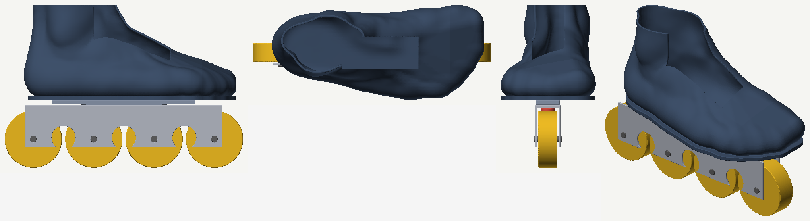
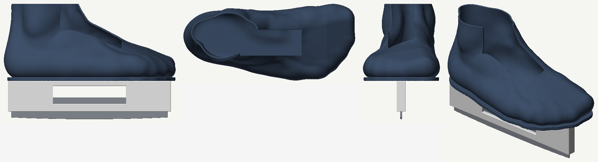

# custom-skate

Two custom hockey skates, one for ice and one for roller, on boots made from a 3D scan of the
skater's feet. The roller skate rides an aluminium chassis that rocks like Marsblade's but weighs
the same as a premium one-piece chassis; boot and chassis are designed together, so the boot's sole
is the part that rocks. The ice skate takes a dynamic (rocking) blade holder. Modelled with
[CortenForge](https://crates.io/crates/cortenforge). The chassis came first, so most of this page
is about it; the boot plan is in `docs/PLAN.md` (track B).



*Round 1 on a stand-in foot: the boot grown from a 3D foot scan, the rocker under its sole, the
lower frame and four 72 mm wheels. A first layout, not a design yet (see Round 1 below).*



*The ice skate: the same boot on a 254 mm holder. The holder is a placeholder until the real one
(a Marsblade i2) is measured.*

A Marsblade-style frame is split in two. A rounded upper chassis carries the boot and rocks
heel-to-toe on a flat lower chassis that carries the wheels, held together by a sprung coupling.
The skater's foot can pitch the way it does on an ice blade while all four wheels stay on the
floor. The catch is weight. The two-piece frame is far heavier:

| Chassis | Weight | Source |
|---|---|---|
| Hi-Lo Kryptonium, 7000-series one-piece | 175 g (S/M), 184 g (L), with axles and spacers | Coast Hockey Shop |
| Rink Rat Rinkster Sniper Hi-Lo, 7075-T6 one-piece | ~170 g (MD) | Inline Warehouse |
| Konixx Bolt Hi-Lo, one-piece | 173 g (MD) | Ice Warehouse |
| Marsblade R1 (glass-fibre nylon upper, Al-Mg lower) | 282 g without wheels and bearings / 302 g (MD) | Hockey World Blog / Inline Warehouse |
| Marsblade O1 (resin) | 376 g (MD) | Inline Warehouse |

**The goal is a rocking chassis in the 170-185 g class: about 110-130 g lighter than the R1.**

## Why rock? The science

1. **The geometry: Daggfeldt & Petré (2025)**, Swedish School of Sport and Health Sciences (GIH),
   *Proc IMechE Part P*, [doi:10.1177/17543371251389073](https://doi.org/10.1177/17543371251389073).
   On ice, the foot can pitch only as far as the blade rolls. Moving the contact point 30 cm on a
   2.7 m (9 ft) blade gives about 6.4°. A smaller blade radius would give more pitch, but it
   shortens the contact with the ice and raises plowing resistance. A rocker between the holder and
   the blade separates the two: pitch is set by the rocker radius, glide by the blade radius.
   Their equations are in `src/pitch.rs`, checked against the paper's own numbers.
2. **The Canadian study: Lockwood, Dunne, Hsu (Brock University) and Ellingson (George Brown
   College), 2023**, "Effect of a Fixed versus Dynamic Pitch on Hockey-Specific Skating Skills"
   ([poster PDF](https://images.marsblade.com/uploads/2023/12/poster_spin-2023_fixed-versus-dynamic.pdf)).
   11 collegiate players skated on a treadmill and on ice, wearing IMU motion capture and pressure
   insoles. On Marsblade's i2 dynamic holder, the in-skate forces were lower at the same speed:
   forward skating on the treadmill had 5% lower mean force, 8% lower peak force and 8% lower
   impulse. C-cuts and backward skating had longer strides and larger joint angles.
3. **The sprint study: Psilander, Arndt & Petré (2025)**, *Footwear Science*,
   [doi:10.1080/19424280.2025.2563837](https://doi.org/10.1080/19424280.2025.2563837): elite
   players skated backward 1-2% faster on the dynamic holder.

**What this means for roller.** A one-piece roller chassis is a flat, rigid line of wheels. The
foot can pitch only by tipping the whole frame onto its end wheels. A rocker on a flat lower
chassis is the paper's model with a flat "blade" (s → ∞): the foot pitches x / r while every wheel
stays down. From `cargo run --release -- pitch`:

| | deg of foot pitch per cm of weight shift |
|---|---|
| Ice blade, 9 / 11 / 13 ft | 0.209 / 0.171 / 0.145 |
| Roller rocker, 5 / 7.5 / 10 / 15 ft (the R1's inserts span 5-15 ft) | 0.376 / 0.251 / 0.188 / 0.125 |
| One-piece roller chassis | 0 until it tips |

So the R1's rocker range brackets an ice blade's. The rocker gives a roller skate an ice
skate's pitch back.

**Limits of the evidence.** None of these studies tested a roller chassis; all three tested the
i2 ice holder, which uses the same rocker. The Brock / George Brown study is a conference poster
hosted by Marsblade. Its force numbers come from insoles inside the boot, not from the blade on
the ice, and the poster marks none of the force differences as significant. The GIH sprint study
found a gain only in backward skating. Details and numbers are in `docs/RESEARCH.md`.

## Run

```
cargo run --release -- check         # every tool used, against known results (26/26)
cargo run --release -- pitch         # the pitch tables above
cargo run --release -- scan <file>   # measure a foot scan (OBJ, STL, PLY)
cargo run --release -- round1 <scan> # the whole skate on one foot -> out/round1 (STL, PNG)
cargo run --release -- chassis       # the round-2 roller chassis alone: weighed, rocked, checked -> out/chassis
```

Builds go to `D:/cargo-target/custom-skate` (`.cargo/config.toml`, local only). The first
release build takes about 3 minutes.

## Round 1: the whole skate on an example foot

Every stage, end to end, on a stand-in foot (a CC0 research scan): the foot, a last with a toe
box, the boot shell and liner, a fit map, a roller chassis with the rocker under the sole, and an
ice holder placeholder. Round-1 quality: a first layout, not a design. The picture at the top of
this page is its roller skate.

- Boot shell 277 g printed in PA 12 (425 g in carbon/epoxy), liner 44 g.
- Fit: snug (~1 mm) at the heel, midfoot, instep and ball; room only round the toes.
- Roller chassis, first layout: 281 g, the same as a Marsblade R1. The lower frame is 208 g of
  it, so that is where the ~100 g to the one-piece class (170-184 g) has to come from.

More pictures and the numbers: `docs/round1/`, and `docs/PLAN.md` (Round 1).

## Round 2: the chassis to weight

Following the loads by hand changed the layout. Vertical loads hardly size a frame. What does is
**roll**: the sideways push at the wheels acts ~80 mm below the sole, and a rocking joint has to
pass that moment across. Round 1's rocker sat on top of the lower frame, narrow and high, where
it can't. So in round 2 the upper hangs two truss walls outside the lower rails. Each wall's foot
is the rocker arc, and it rolls on a low ledge on the rail. The vertical load alone then holds
the roll up to a sideways / vertical ratio of 0.37, against ~0.19 for round 1.


*The round-2 chassis rocked toe-down to the end of its travel (contact 50 mm forward, 1.25° of
foot pitch). Dark: the upper, its truss wall hanging outside the lower rail; its bottom edge is
the rocker arc, rolling on the ledge above the axles. All four wheels stay down.*

- **Step 1: 174 g** with axles, spacers and the coupling, down from round 1's 281 g. All
  vertical-load checks pass by hand formulas (worst at 0.74 of its allowable, for a 100 kg skater
  at 1.5x body weight striding and 3x landing). A one-piece built from the same members weighs
  111 g, so the rocker costs 63 g.
- **Step 2: FEM.** CortenForge's soft-body solver, sim-soft, works as a linear-elastic solver for
  aluminium: within 1% of beam theory once run static and at a small fraction of the load. Its
  reaction readout lets the two-piece frame be solved as two linked models.
- **The sideways push sizes the frame.** At 0.45 of the stride load, the 174 g frame's thin parts
  go past yield. So the sizing is like for like: a one-piece thickened to real weights sets the
  target, under the same loads and the same boot mounts. At 170 g it gives 0.35 mm sideways at
  the axles, peak 208 MPa.
- **By thickening alone, the rocker can't match that at a sensible weight.** The stiffest run is
  0.42 mm at 288 g. At equal stiffness the rocker costs 76 g more than a one-piece at 2 mm
  parts, and 103-127 g as it nears the one-piece's stiffness; that is roughly R1 weight
  (282-302 g). The reason: the upper's walls carry the push up to the boot as plates bending
  out of their own plane, the job a one-piece's rails do, so the lower frame is the extra.
  Bonding the upper to a custom boot's sole makes it ~40% stiffer.
- **Leaning the walls into a V doesn't help overall.** Leaning them so that, from the front,
  they meet at the wheels' contact patch, the push runs along the walls instead of bending them:
  the upper gives 6x less. But a tilted seat only touches at the rolling contact, mid-length, so
  the lower has to carry the push lengthwise to it, and it twists. Best: 1.00 mm at 228 g, no
  better per gram than thickening.
- **Ribbed walls do better, and bonded to the boot's sole they reach one-piece stiffness.** A rib
  on every member of the walls makes each a T-section. Bolted at two mounts that saves 10-20 g
  over thickening, still 81-92 g over a one-piece as stiff. Bonded along a custom boot's sole
  (modelled as rigid, so a best case), it gives 0.37 mm at 223 g and 0.28 mm at 244 g, against
  0.35 mm for the 170 g one-piece: about 60-70 g over a one-piece, and 40-80 g under an R1.
  Next: the custom-boot route with a real sole, or pinned links that pass the push near the
  mounts (`docs/PLAN.md`).

Pictures and numbers: `docs/round2/`, and `docs/PLAN.md` (Round 2).

## Status

Phase 0 (the science, the pitch model, the mass tool checked), round 1 (the whole skate on an
example foot), round 2's first step (the chassis to weight) and the like-for-like FEM sizing of
step 2 are done. See `docs/PLAN.md` for what comes next and `docs/CORTENFORGE.md` for what
CortenForge did well and where it fell short.

## Patents

Marsblade's split rocking frame is patented: US 9,782,665 B2 (Flow Motion Technology AB, active;
Google Patents estimates expiry 2031-02-02). Bauer holds a scan-to-last patent, US 12,135,869 B2.
Modelling and studying them is research. Check the patents before making anything to sell.

## Privacy

Foot scans and photos stay out of git (`scans/` and `measure/` are ignored). Only measurements
written into the docs are published.

## License

Code and docs: MIT or Apache-2.0, at your option (`LICENSE-MIT`, `LICENSE-APACHE`).
