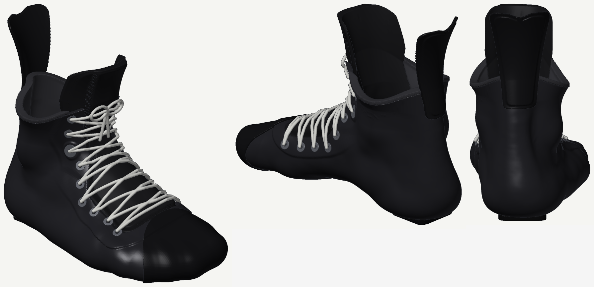
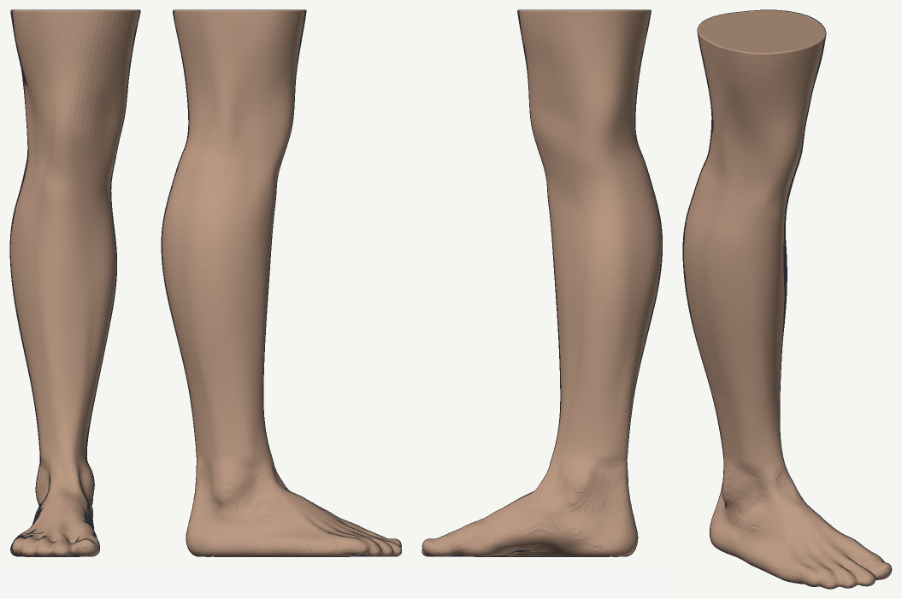
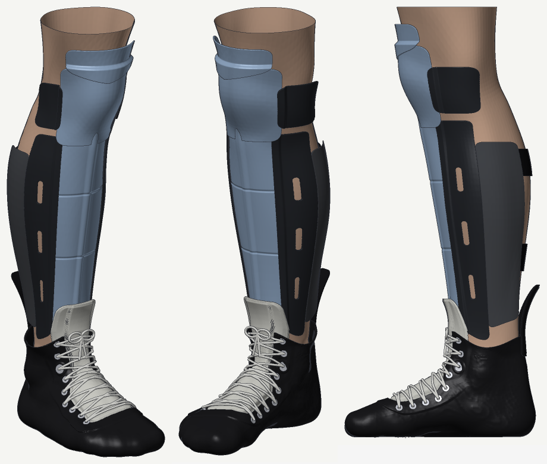
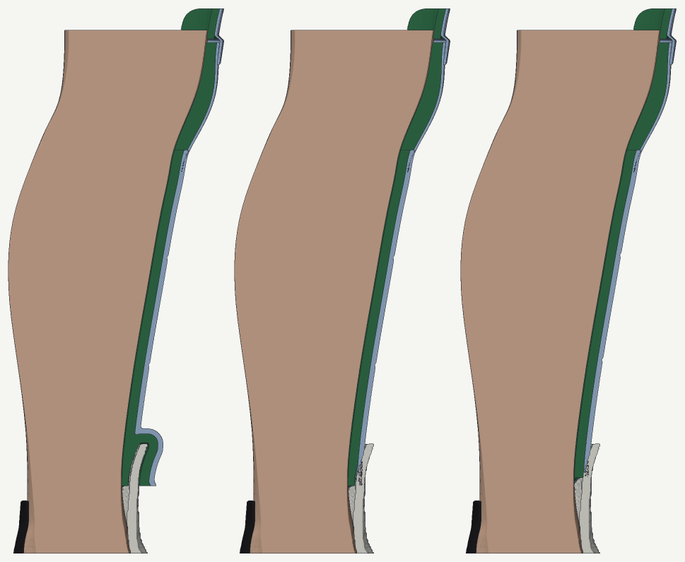
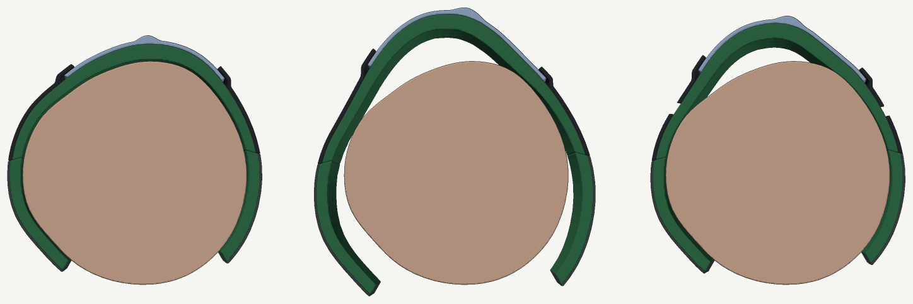
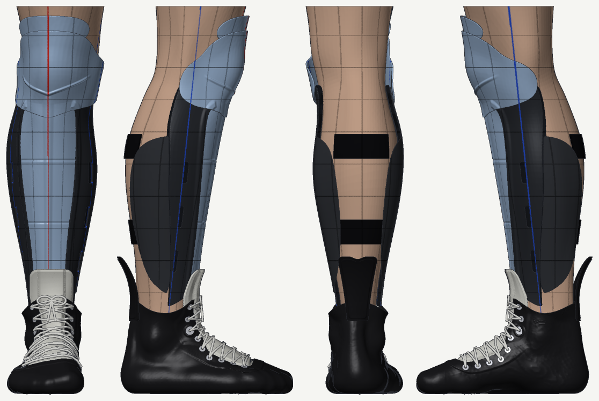
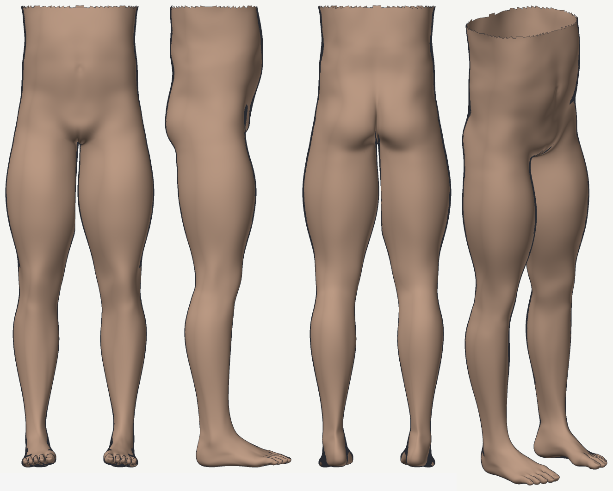
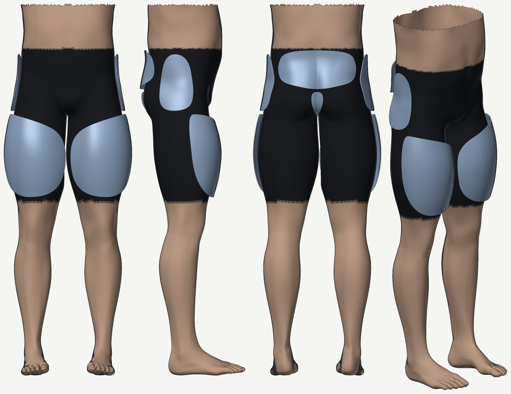
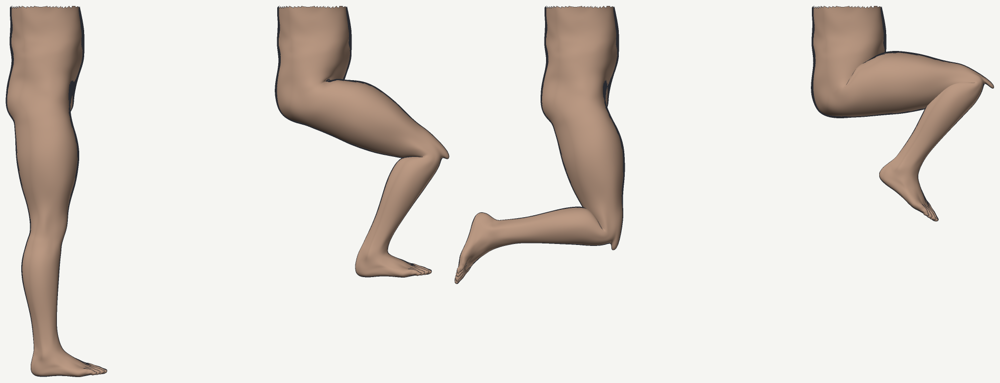

# Plan

**Scope (Jon, 2026-11-10): the full skates, "one ice skate, one roller skate".** Custom boots made
from a 3D scan of Jon's feet; the roller skate on an aluminium rocking chassis designed with its
boot, the ice skate on a dynamic (rocking) blade holder. Three tracks that meet in the sole:

- **Track A, the chassis**: an aluminium rocking roller chassis (rounded upper chassis on a flat
  lower chassis, sprung coupling) in the 170-185 g class of premium one-piece 7075 chassis, strong
  and stiff enough to play on. The Marsblade R1 is 282-302 g. Phases 0-7 below.
- **Track B, the boot**: scan → last → shell → liner → fit simulation → test shells → a real boot.
  Phases B1-B7 below.
- **Track C, the skates**: roller, the boot's sole becomes the chassis's upper (the part that
  rocks), so a whole part, the rivets and the mount plate go away; that is the biggest weight
  lever we have. Ice, a one-piece skate: the boot runs down into our own rocking holder, with
  our own runner and rocker insert (nothing proprietary, Jon 2026-11-11).
- **Track D, the gear** (Jon, 2026-11-12: "id like to actually do full hockey equipment"):
  shin pads first, made with the skate as one system; the helmet parked. Below, after Jon's
  list.

Everything is modelled in CortenForge and checked against known results first (CLAUDE.md).

What CortenForge brings:
- **cf-design**: SDF solids, `mass_properties` (grams), the `mechanism` module (parts, joints,
  MJCF out to sim-core, an elastomer `Bushing`), meshing, STL.
- **sim-core**: rigid-body dynamics with contact, for the rocking frame on its wheels.
- **sim-soft**: hyperelastic FEM (Neo-Hookean, Yeoh) on tet meshes built from SDFs. A natural fit
  for the rubber bushing, and possibly for aluminium at small strain (untested).
- **sim-opt**: optimisers (simulated annealing, CEM) for the mass search.
- **mesh**: printability checks, repair, STL out.

## Round 1: the whole skate on an example foot (DONE 2026-11-10)

Jon: "before we do anything on my side i think we should just do the full thing on an example
foot". `cargo run --release -- round1 scans/stand-in/022_fBW_R.ply` (~2.5 min) runs every stage
at round-1 quality on stand-in 022 (man, 175 cm, loaded foot 252 x 104 mm). Renders and the
summary are in `docs/round1/`; STLs go to `out/round1/` (not in git).

- **Foot** (`foot.rs`): the scan in a standard frame (heel at x = 0, toes +x, floor z = 0), with a
  mesh-sdf distance grid (1.5 mm, ~26 s).
- **Last** (`round1.rs`, `foot.rs`): the foot closed by 12 mm (arch and small hollows filled) +
  the convex hull of the forefoot from 62% of the length (cf-geometry Quickhull) as the toe box,
  faded in over 60 mm, + 1 mm ease. Closing alone can't make a toe box (toes are ~20 mm cylinders
  side by side; closing by r leaves a groove ~a^2/2r deep; 7 and 18 mm both left visible grooves).
- **Boot** (`boot.rs`): liner 4 mm, shell wall 2.5 mm, trimmed at 110 mm, throat 40 mm wide from
  32% to 70% of the length, flat 3 mm sole plate. **Shell 277 g in printed PA 12, 425 g in
  carbon/epoxy; liner 44 g** (foam density assumed).
- **Fit** (`fit.rs`): gap from the real foot to the last. Heel, midfoot, instep and ball sit at
  ~1.0 mm (the ease); room only between and over the toes (p90 4-8 mm). Round 1's last never
  cuts in, so this is a room map, not pressure.
- **Roller chassis** (`chassis.rs`), a first layout, not a design: 4 x 72 mm wheels on a 76 mm
  pitch, a 7075 rocker under the sole (7.5 ft radius, 6 mm, pocketed), two 2.5 mm 7075 rails with
  scallops and a 4 mm bridge it rolls on, a Ti M6 bolt through an 18 x 10 mm PU bushing hung in the
  V between the middle wheels; ground 85 mm below the boot sole. **281 g: rocker 48, lower frame
  208, axles 20, bolt 3, bushing 3.** No clashes between the wheels and the frame, bolt or
  bushing. So the naive layout weighs what the R1 does (282-302 g); the job is ~100 g out, and
  the lower frame (208 g) is where it is.
- **Ice skate**: the same boot on a 254 mm holder **placeholder** (i2 not measured yet).
- Not in round 1: strength (phase 3), the spring rate (phase 4), dynamics (phase 5), heel lock,
  tendon guard, eyelets, tongue, variable wall thickness, the i2's real mounting pattern.

## Round 2: the chassis to weight (step 1 DONE 2026-11-10)

Jon: "start round 2". Plan: (1) the chassis to the weight target, (2) strength, (3) the last
tighter at the heel and midfoot, (4) Jon's own foot. `cargo run --release -- chassis` (~2 min,
`src/frame.rs`, `src/strength.rs`, `src/round2.rs`) builds the chassis alone, weighs it, checks
clashes at rest and rocked to both ends, runs the hand-formula checks, renders `docs/round2/`.

**What following the loads by hand showed** (`strength.rs`; loads in RESEARCH.md 13):
- Vertical loads barely size a frame: round 1's rails were ~5x stronger than they needed to be.
- Round 1's 6 mm rocker was the weak part: it bridges from heel to ball over the contact, ~100 N m
  at 3 BW on a 30 x 6 mm section, past yield.
- **The real driver is roll.** The lateral push at the wheels (0.3-0.6 BW in the skate's frame,
  speed skating) acts ~80 mm below the sole. A rocking joint has to pass that roll moment. Round
  1's rocker sat on top, 79 mm up and 30 mm wide: the vertical load alone holds a lateral /
  vertical ratio of only ~0.19 before one side lifts, so everything above that must go through
  bending walls or the bolt. This is probably where the R1's weight goes too.

**So round 2 moves the rocker down and out** (`frame.rs`): the upper is a web under the sole and
two walls hanging outside the lower rails; each wall's foot is the rocker arc (7.5 ft), rolling on a
ledge on the rail's outer face just above the axle heads. The tracks are 34 mm apart and 46 mm up,
so the vertical load alone holds lateral / vertical up to 0.37. Both the walls and the rails are
Warren trusses in their own planes (deep, so stiff for their weight). Bolt + bushing in a ring
between the middle wheels; two ties across the walls' feet through the rails' truss windows.

**Result (stand-in foot 252 mm, 4 x 72):**
- **174.2 g** with axles, spacers, bolt, nut and bushing: upper 57.0, ties 4.0, lower 77.9, axles
  21.7, spacers 5.8, bolt 3.9, nut 1.3, bushing 2.7. Round 1 was 281.4 g; one-piece 7075 frames
  are 170-184 g (bigger sizes); the R1 282-302 g.
- No clashes at rest or rocked +-50 mm (+-1.25 deg); the frame leans to 64 deg before touching
  the ground, after the axle heads (61 deg).
- Hand checks (100 kg skater; stride 1.5 BW fatigue, impact 3 BW static): worst stress / allowable
  0.74 (the ledge and bottom chord between bosses, 125 MPa at the stride). Upper 54 MPa, lower
  65 MPa, wall feet 119 MPa, axles <= 88 MPa, contact 64 MPa peak.
- **Like for like:** a one-piece built from the same members (same rails, wheels, stack, axles)
  weighs 110.9 g, so the rocker costs 63.3 g. The first sizing (2.5 mm rails and walls) weighed
  221.4 g and cost 101 g over its one-piece, about the R1's premium over real one-pieces.
- Our one-piece at 111-134 g is lighter than real ones (170-184 g, bigger sizes), so our members
  are probably on the light side of what frame makers use, likely for impact, wear and lateral
  stiffness. The 174 g is a paper weight until the lateral case is checked.
- Sweep (`examples/sweep_frame.rs`): the lower truss's top chord is essential (without it the
  lower is 3.8x over); the ties are 4 g; 1.8 mm members reach 168 g at 0.82.
- sim-opt didn't fit a mass search: its optimisers train policies on sim-core environments, there
  is no plain minimise (CORTENFORGE.md). The sweep did the job, and few parameters are active.

**Not checked by step 1, and it decides the design:** the lateral push (662 N at the stride)
bending the walls and rails sideways, torsion, buckling of the 2 mm walls, stress at holes and
corners. Step 2 below.

## Round 2, step 2: FEM (first results 2026-11-10)

Jon: "lets do round 2, step 2". `src/fem.rs`: sim-soft as a linear-elastic solver (Tet10 from the
cf-design solid, static, solved at 1e-3 of the load and scaled back, stresses recovered by us).
Experiments: `examples/fem_cantilever.rs`, `fem_probe.rs`, `fem_lower.rs`.

- **The solver checks out** (`check` 25/25): a 7075 cantilever's tip deflection within 1% of beam
  theory (3.5% where the mesher shaved an edge) and its bending stress within 0.5%; a 2 mm strip
  bent sideways 0.97-0.99 and 1.00-1.01. Two fixes were needed, both in CORTENFORGE.md: density 0
  (static), and the load scaling (sim-soft's finite-strain Newton stalls on slender aluminium at
  full load).
- **The lower frame, vertical stride** (full model with its axles, 2 mm cells, held at the rocker
  contact and by the walls along the rails): peak 181 MPa at the bottom edge of the rails under
  the contact. The hand formula said 125 MPa there, so it was ~30% low; the 2 mm mesh is also
  9.5% short of material, so the FEM reads high. Both under the fatigue allowable (174 MPa)
  only roughly: this needs a finer mesh.
- **The sideways push (0.45 of the vertical) breaks the 174 g frame**: ~580 MPa (both walls
  bearing on the rails along the upper) or ~530 MPa (one wall), and ~1.8-2.0 mm sideways at the
  axles. The peaks sit where the ledge and its backing end (x = +-70 mm) and near the end axles.
- **But a one-piece built from the same 2 mm members does worse**: ~743 MPa and 2.8 mm (clamped
  at its two mounts; vertical stride alone 94 MPa). The upper's walls hold the rails just above
  the axles, lower than a one-piece's mounts do, which shortens the rails' sideways lever.
  So the rocker layout is not the weak point; 2 mm members are, under this push. That fits
  real one-pieces weighing 170-184 g against our same-member one-piece's 111 g. **(Overtaken
  below: this held the lower against rigid walls. With the upper's walls modelled, they are
  the soft part, and the rocker comes out the softer frame.)**
- With 3 mm rails: ~330 MPa (rocker lower, peak at the sharp end of the ledge) and ~285 MPa
  (one-piece), both under yield, both still over the fatigue allowable at this push.
- The sideways push of 0.45 is from speed skating (RESEARCH.md 13), and it now decides the
  frame's weight. A hockey number would be worth more than any other single input.
- Not done yet: the upper's walls under the push (they carry it from the rails to the boot); a
  finer mesh (1.5 mm: ~3M DOF); torsion; buckling; tapering the ledge ends.

## Round 2, step 2 continued: like for like (2026-11-11)

Jon: "thicken the one-piece model until it weighs what real frames do, use its sideways stress
and stiffness as the target, then size the rocker's rails and walls to match and see what it
weighs". `src/sizing.rs`; one run = `cargo run --release --example size_frame -- <part> key=value
...`, ~2 min for a one-piece, ~3 for a rocker; every run is a row in `docs/round2/size_runs.csv`.

**How the two frames are compared.**
- **The same for both:**
  - loads: 100 kg skater, stride 1.5 BW, sideways 0.45 of it;
  - mounts: clamped on top, 165 mm apart and 36 mm long (an assumption until Jon's TF9 rivet
    pattern is measured);
  - mesh: 2 mm cells.
- **Two measures:**
  - the four axles' mean sideways give;
  - the peak von Mises stress away from the clamps and the rocker contact.
- **The rocker is two models.** The lower is held at its contacts, and sim-soft's reaction
  readout gives the forces there; they sum to the applied loads within 0.1 N, and the readout is
  in `check` (26/26). Those forces then load the upper, clamped at the mounts. The lower rides on
  the upper's contact faces, so the two gives add.
- **The coupling is one way:** the contact forces don't shift as the upper gives.

**The target: our one-piece, its rail plates thickened to real weights** (with axles and spacers;
real ones: 170-184 g):

| One-piece rails | Weight | Mean sideways give | Peak stress |
|---|---|---|---|
| 2 mm | 110.9 g | 2.57 mm | 743 MPa |
| 3 mm | 141.8 g | 0.68 mm | 284 MPa |
| **3.9 mm** | **169.5 g** | **0.35 mm** | **208 MPa** |
| 4.4 mm | 185.0 g | 0.25 mm | 156 MPa |

Give falls as 1/t³ and stress as 1/t², as plate bending predicts. The peaks sit on the rails just
under the inner end of a mount. Even at real weight, the one-piece is over our fatigue allowable
(174 MPa) at this push, which is one more reason to compare like for like rather than against an
absolute limit.

**The rocker, sized by thickness** (upper 240 mm long, 6 wall panels; rails / walls / web in mm;
premium = rocker weight minus a one-piece as stiff, interpolated from the table above):

| Rails / walls / web | Weight | Give: total (lower + upper) | Peak, lower / upper | Premium |
|---|---|---|---|---|
| 2 / 2 / 1.5 | 191.6 g | 2.01 mm (0.15 + 1.86) | 401 / 1,200* MPa | 76 g |
| 2 / 3 / 3 | 238.8 g | 0.84 (0.15 + 0.69) | 415 / 425 | 103 g |
| 2 / 3.75 / 1.5 | 247.0 g | 0.69 (0.15 + 0.54) | 398 / 352 | 106 g |
| 2.5 / 4 / 1.5 | 271.6 g | 0.50 (0.09 + 0.41) | 234 / 288 | 118 g |
| 2.5 / 3.75 / 3 | 281.6 g | 0.47 (0.10 + 0.37) | 237 / 234 | 125 g |
| 2.5 / 4.5 / 1.5 | 288.1 g | 0.42 (0.09 + 0.32) | 234 / 239 | 127 g |

*The 2 mm wall is one element thick at this mesh. Its peak sits where the contact loads go in,
and is mostly a modelling artefact.

**What it found.**
- **By thickening alone, the rocker doesn't reach a real-weight one-piece's stiffness at a
  sensible weight.**
  - The stiffest rocker run is 0.42 mm at 288.1 g; the 170 g one-piece gives 0.35 mm.
  - Following those last runs on, 0.35 mm comes at roughly 300 g: the R1's weight (282-302 g).
  - The premium at equal stiffness grows as the target stiffens: ~76 g at 2 mm parts,
    103-127 g as the rocker approaches the one-piece's stiffness.
  - Stress tells the same story: ~235 MPa at the stiffest rockers against 208 MPa for the
    170 g one-piece.
- **Why: the walls do the job a one-piece's rails do.** They carry the push 35-40 mm up to the
  boot as plates bending out of their own plane. So they end up as thick as a one-piece's rails,
  and the whole lower frame is the premium on top. Of the give, 0.09-0.15 mm is in the lower and
  the rest in the upper:
  - **The walls' own bending** falls roughly as 1/t³ (2 → 3.75 mm walls: 1.86 → 0.54 mm).
  - **A floor of ~0.2 mm that thicker walls don't remove.** Between the two mounts the upper
    twists like an open U-channel, and its windowed web shears in its own plane (0.13 mm at the
    centre).
  - **The web:** against the 1.5 mm windowed web, a 3 mm web takes 0.09 mm off for 18 g, and a
    solid 3 mm web 0.18 mm for 62 g.
- **The upper has to cover the mounts.** Step 1's 180 mm upper doesn't reach the assumed mounts
  (±100.5 mm). With 2 mm parts:

  | Upper length | Weight | Give: total (lower + upper) |
  |---|---|---|
  | 180 mm (step 1) | 174.2 g | 3.09 mm (1.03 + 2.06) |
  | 204 mm (just covers the mounts) | 180.0 g | 2.73 mm (0.19 + 2.54) |
  | 240 mm (covers the end axles too; 6 wall panels) | 191.6 g | 2.01 mm (0.15 + 1.86) |

  With its walls modelled, step 1's 174 g frame gives 3.09 mm, softer than the one-piece from
  the same 2 mm members (2.57 mm).
- **At the 0.45 push nearly all the vertical load moves to one ledge** (1,438 of 1,472 N). Both
  ledges stay in compression, so the low ledges do hold the roll, as designed; the coupling
  bolt isn't needed for it.
- **Bonded to a custom boot's sole** along its length (track C) instead of bolted at the mounts,
  the upper gives ~40% less (the whole frame ~33% less): 0.32 mm at 281.6 g (2.5 / 3.75 / 3),
  under the 170 g one-piece's 0.35. That's not like for like (a one-piece bonded the same way
  would gain too), but it is the lever a custom boot offers.

**Limits of these numbers.**
- **Mesh:** 2 mm cells lose 5-10% of thin parts' volume. The rocker's thinner parts lose more,
  so they read a little soft.
- **Coupling:** one way only.
- **Load cases:** the rocker at rest only; with the contact between two wall-truss nodes
  (rocked), the foot carries the 1.4 kN point load in bending. No torsion case yet.
- **Peak stresses** on the lower sit at the ends of the side-bearing band, where its rigid
  support begins.
- **The one-piece stand-in** is our own truss with thicker plates; a maker's sections may be
  more efficient, which would make the target harder.

**Next, for Jon to choose** (superseded by the V section's list below):
1. **Stiffer walls per gram than a plate.** Ribs or gussets on the walls' outer faces, deep at
   the root where the bending moment is, plus a web with diagonal ribs instead of windows.
   By hand, a 3 x 6 mm rib makes 40 mm of 2 mm wall ~10x as stiff for ~2 g.
2. **Take the side push high**, at the web, where the upper is stiff in its own plane. The
   rails then work like a one-piece's, but by hand the roll then needs ~1.4 kN from the bolt at
   0.45. A bushing can't give that, so it would take a hard stop.
3. **Build the roller skate on the custom boot**, with the upper bonded to the sole (track C).
4. **Accept a heavier rocker** and size it to a softer target.

A hockey sideways-load number still matters most for absolute stress, less for this
comparison. Then the coupling (phase 4) and steps 3-4.

## Round 2, step 2: the V section, "less material" (2026-11-11)

Jon: "how could we engineer this so theres less material needed?", then "go ahead" on the first
two ideas: point the parts at the wheels' contact patch, and make the web a truss.

**The idea.** In front view the ground force enters at one point, the contact patch. Two
members whose lines meet there carry any force through it by tension and compression, with no
bending. So the walls lean out along the line from the patch through their feet (20.3°: ~62 mm
apart at the web instead of 36), and the ledges tilt square to that line (`FrameParams::vee`).
The lower's rails already lie within ~1 mm of that line below the ledge.

**The catch, found while building it.** A tilted ledge can only press where the arc touches it:
the rolling patch, mid-length. The upright layout's side bearing, which slid along the whole
wall, has no tilted equivalent (only a face square to y allows the rocking motion). So each
axle's push has to travel lengthwise: through the lower to the patch, and through the upper to
the mounts. Two more options carry it: `web_truss` (the web as a Warren truss in plan) and
`deck_panels` (a truss deck across the lower's rails, over the wheels), and then `bulk_t`
(plates across the rails in the gaps between wheels, clear of the tyres by 0.75 mm).

**Modelling.**
- **Mesh:** a 2 mm wall leaning across the 2 mm mesh lattice fell apart (the upper lost 70% of
  its volume), so the uppers here are meshed at 1.5 mm (`cell_up`; -5.3% leaning, -4.0%
  upright), and the upright layout re-run that way for a like-for-like baseline.
- **The tilted contact:** sim-soft holds nodes only along x, y and z. So the heavy side's patch
  is pinned (it may stick by friction) and the light side presses along its tilted normal
  only, with the force that leaves no roll moment on the heavy patch (two solves superposed;
  `sizing::lower_vee`). The lower then rides on the upper's feet the same way.
- **A first try held both patches pinned.** The light side then carried 148 N of sideways force,
  which a contact can't, and it bent its 2 mm wall 2 mm locally. That run is superseded (its row
  in out/size/runs.csv reads 0.264 mm, which is wrong).

**Results** (2 mm parts, 1.5 mm web, upper 240 mm, 6 wall panels; lower at 2 mm cells, upper
at 1.5 mm):

| Frame | Weight | Give: total (lower + upper) | Peak, lower / upper |
|---|---|---|---|
| Upright (the step-2 layout), re-run at the finer mesh | 191.6 g | 1.75 mm (0.15 + 1.60) | 401 / 991* MPa |
| V | 202.5 g | 1.73 (1.45 + 0.27) | 598 / 345 |
| V + deck (6 panels) | 213.7 g | 1.35 (1.07 + 0.27) | 451 / 345 |
| V + truss web + deck (4 panels each) | 217.2 g | 1.34 (1.08 + 0.25) | 454 / 344 |
| V + truss web + deck (6 panels each) | 222.6 g | 1.33 (1.07 + 0.26) | 451 / 338 |
| V + deck + 2 mm bulkheads | 227.5 g | 1.00 (0.73 + 0.28) | 321 / 345 |

*As before, the 2 mm upright wall's peak sits where the contact loads go in.

**What it found.**
- **The V works in front view, as designed.**
  - The heavy side presses 1,750 N (hand: 1,739) and needs friction of only 0.01, so the push
    runs along the wall.
  - The upper carries the axles 0.27 mm instead of 1.60. At mid-length its wall foot moves
    0.16 mm instead of 2.70.
  - The light side pulls 184 N at the 0.45 push, so the coupling bolt needs a preload of at
    least 346 N (hand: ~320). That is well under the 1.4 kN of "take the push high".
- **But the gain moves into the lower.** With the push crossing only at the middle, the lower
  carries each axle's push, and its twisting moment, up to 114 mm lengthwise. Its section is
  open (two rails, plus a deck if added), so it twists. At the end axles:

  | Lower | Roll of the section | Rails leaning (racking) | End axles' sideways give |
  |---|---|---|---|
  | Deck only | 0.028 rad | 0.35 mm | 1.9 mm |
  | Deck + bulkheads | 0.024 rad | 0.15 mm | 1.3 mm |

  The inner axles (38 mm from the middle) give 0.17-0.26 mm. The bulkheads stop most of the
  racking, but the twist is the bigger part.
- **The truss web stiffens the web** (its top moves 0.02 mm instead of 0.07 at mid-length), but
  the web was no longer where the give was.
- **Per gram, the V is no better than thickening.** At 1.00 mm the V costs ~97 g more than a
  one-piece as stiff (interpolated as in the table above). The thickened upright frames cost
  76-127 g.
- **Why the upright layout's lower was so stiff:** the side bearing held it sideways along its
  whole length (0.15 mm). Whichever way the push crosses, one of the two parts pays:
  - along the length (the side bearing), the walls bend;
  - at one place (the rolling contact), the lower twists.

**Limits.**
- The V runs are at rest only, with the contact mid-length; rocked, the patch moves 50 mm
  toward one end.
- Coupling one way, as before.
- In the deck-only V the end of the lower's rail swings to within ~0.1 mm of the upper's wall
  foot, which would start a side contact the model doesn't have.
- The bulkheads' 0.75 mm clearance to the tyres is tight for real wheels.

**Next, for Jon to choose** (superseded by the ribbed walls' list below):
1. **Upright layout, ribbed walls** (old option 1). The upright layout keeps the lower stiff
   (0.15 mm), and its walls' bending was 1.60 of its 1.75 mm. Ribs attack that directly: by
   hand, a 3 x 6 mm rib makes 40 mm of 2 mm wall ~10x as stiff for ~2 g.
2. **A torsion box for the V's lower**: a closed cell along the frame. The only room is above
   the wheels, under the upper's web (8 mm of stack there today), so a box deep enough to matter
   raises the boot by ~10 mm.
3. **Pass the push near the mounts instead of mid-length**: two short links with pins across
   the frame, front and back, in place of the rolling arcs. Neither part then carries the push
   lengthwise. A four-bar's motion only approximates the rocker arc, so this is a new joint,
   with its own kinematics to check.
4. **Bond the upper to the custom boot's sole** (track C), as before: ~40% stiffer.
5. **Accept a heavier rocker.**

## Round 2, step 2: ribbed walls, and bonded to the sole (2026-11-11)

Jon: "try the ribbed walls on the upright layout", and the pinned links and the bonded sole
"both are interesting".

**The ribs** (`FrameParams::rib_d`, `rib_t`, `rib_taper`, `rib_chords`). Every truss member of
each wall gets a rib on its outer face, so it bends sideways as a T-section, not a flat strip:
the diagonals, the top chord (the wall's root, at the web) and the foot chord. The ribs are
2 mm thick and stand out 3-5 mm, so the walls are 42-46 mm across instead of 36. The upper is
meshed at 1.5 mm like the V runs (thin ribs at an angle need it; -2.2% to -3.3% volume), and
the comparisons below are all at that mesh.

**Results** (2 mm rails and walls, 1.5 mm web, upper 240 mm, 6 wall panels; premium = weight
minus a one-piece as stiff, interpolated as before):

| Upper | Weight | Give: total (lower + upper) | Peak, upper | Premium |
|---|---|---|---|---|
| Plain 2 mm walls | 191.6 g | 1.75 mm (0.15 + 1.60) | 991* MPa | 75 g |
| Walls thickened to 3.75 mm | 247.0 g | 0.59 (0.15 + 0.44) | 265 | 101 g |
| Ribs 5 mm, diagonals only | 214.8 g | 1.00 (0.15 + 0.85) | 481 | 85 g |
| Ribs 5 mm, diagonals + foot chord | 229.3 g | 0.67 (0.15 + 0.52) | 290 | 87 g |
| Ribs 3 mm, all members | 222.9 g | 0.68 (0.15 + 0.53) | 274 | 81 g |
| Ribs 5 mm tapering to 2 mm at the foot | 228.1 g | 0.62 (0.15 + 0.47) | 273 | 84 g |
| Ribs 5 mm, all members | 243.8 g | 0.49 (0.15 + 0.35) | 197 | 92 g |

*At the contact, where the loads go in; as before mostly a modelling artefact.

**Bonded to a custom boot's sole** (the whole web top held instead of the two mounts):

| Upper, bonded | Weight | Give: total (lower + upper) | Peak, lower / upper |
|---|---|---|---|
| Plain 2 mm walls | 191.6 g | 1.19 mm (0.15 + 1.04) | 401 / 905 MPa |
| Ribs 3 mm, all members | 222.9 g | 0.37 (0.15 + 0.22) | 401 / 312 |
| Ribs 5 mm, all members | 243.8 g | 0.275 (0.15 + 0.13) | 401 / 167 |

**What it found.**
- **Ribs beat thickening, by less than the hand sum promised.** At about the same weight, 5 mm
  ribs give 0.49 mm and 3.75 mm walls 0.59. At about the same give (0.6 mm), ribs save ~19 g.
  The premium falls from 101 g to 81-92 g. The hand sum (a rib makes a strip of wall ~10x as
  stiff for 2 g) holds for a strip; on the frame it doesn't, because a rib on every member of
  both walls is 31-52 g, and the lower (0.15 mm) and the web don't change.
- **The top chord's rib earns its place.** It is the wall's root, and with it the web twists
  less: at mid-length the web moves 0.11 mm with it, 0.28 mm without.
- **Bolted at two mounts, the rocker still doesn't reach one-piece weight.** The premium is now
  mostly the lower: it weighs 77.9 g, about what a whole one-piece frame does (83 g without
  axles).
- **Bonded to the sole, ribbed walls reach one-piece stiffness.**
  - 0.37 mm at 222.9 g (3 mm ribs), 0.275 mm at 243.8 g (5 mm ribs), against 0.35 mm for the
    170 g one-piece and 0.25 mm for the 185 g one.
  - That's ~60-70 g heavier than a bolted one-piece as stiff, and ~40-80 g lighter than an R1
    (282-302 g).
  - Not like for like: a one-piece bonded to a sole would gain too, and the model holds the
    sole rigidly, so these are best cases.
  - With 5 mm ribs the upper's peak is 167 MPa, under the fatigue allowable (174). The lower's
    401 MPa (at the end of the side-bearing band, partly a modelling artefact) is now the
    highest stress, and its 0.15 mm more than half the give.

**Limits.** At rest only; one-way coupling; the bonded runs hold the sole rigidly. The ribs
widen the frame to 46 mm at the walls, which is less clearance when leaning (to check against
the boot and the lean angles). Ribs this thin need a 1.5 mm mesh, so the earlier 2 mm-mesh
rocker table above reads somewhat soft.

**Next, for Jon to choose** (this replaces the lists above):
1. **The custom-boot route, made real.**
   - Model the boot sole as a real plate, not a rigid clamp: its stiffness is what the bonded
     numbers lean on.
   - Merge the upper's web into the sole (the web is ~13 g, by hand).
   - Lighten and fix the lower, now half the give and the peak stress.
2. **The pinned links** (Jon: interesting). First the motion, no FE: find two links, front and
   back near the mounts, whose pivot moves like the 7.5 ft rocker's contact (35 mm under the
   sole, moving forward ~40 mm per degree of pitch) over the ±50 mm travel. Then the link and pin
   forces from the loads, then the structure, like for like. The pins need no play (preloaded
   bearings, or flexure links: thin strips that bend instead of pins that turn). Check the
   patents before making one (README).
3. **Bolted at two mounts (Jon's TF9s):** ribbed walls, 81-92 g over a one-piece as stiff.

## Track B, round 2: the hockey boot (2026-11-11)

Jon: "lets not use anything proprietary, so no i2 inserts. can we work on the boot first? it
would be cool to see the full boot in its glory then go back to the bladeholder".
`cargo run --release -- boot scans/stand-in/022_fBW_R.ply` (~15 min with the leg since
2026-11-12; `BOOT_VIEWER=1` adds the 3D viewer's light meshes, seconds more) builds the whole
boot on stand-in 022 (`src/hockey_boot.rs`).
Renders and the summary are in `docs/boot/`; STLs and the viewer's files go to `out/boot/`. The
viewer page is `viewer/boot.html` (turn, explode, cut through the ankle or lengthwise).
Its meshes are the uniform ones decimated by our own `cluster_decimate`: cf-design's
`mesh_simplified` left spikes and slivers that Jon spotted in the first viewer (CORTENFORGE.md).

**Placed from the scan, not from fractions of the length.**
- **The ankle bones:** the outermost skin points each side in the ankle region. On 022 the
  medial one is at (66, 46, 84) and the lateral at (48, -23, 78) mm, so the medial one is 6 mm
  higher and 18 mm further forward, as anatomy has it. They set the cuff height, the ankle
  pockets and the pads.
- **The dorsal line:** the line over the top of the foot, from the toes up the instep and the
  front of the shin. Rays are fanned from behind the ankle to find it, and it is centred
  between the sides of the foot and leg. The throat, tongue, eyelets and laces follow it.
  Centring matters: the shin's most forward point sits 6-9 mm toward the medial side, and
  following it put the medial eyelets on the side of the ankle.
- **The leg:** the scan stops 125 mm up. At first the leg above 110 mm was carried up as a prism
  of its own section; since 2026-11-12 the boot is built on the scan joined to the stand-in leg
  (track D1: MakeHuman set to ANSUR II), up to 280 mm. "Rebuilt on the leg" below.

**The parts** (Jon's list, items 1 and 3-6):

| Part | g | Material | What it is |
|---|---|---|---|
| shell | 237.6 | PA 12 | 2.5 mm, cuff trimmed 75 mm above the higher ankle bone (z 159 at the leg's centre, rising 8° to 166 at the back), flaring with the liner at the top (below), ankle pockets bulging 3 mm, an eyelet facing (+1.5 mm) along each side of the throat |
| toe cap | 21.0 | PA 12 | 1.5 mm over the shell's front, ending at the throat |
| outsole | 83.0 | PA 12 | 3 mm flat plate under the shell with a small welt; where track C takes over (the roller's sole becomes the chassis's upper) |
| liner | 35.4 | foam | 4 mm, following the shell's flare at the top, so the room is between the leg and the liner |
| ankle pads | 3.0 | foam | the liner within 24 mm of each ankle bone, 7 mm thick in the pockets |
| footbed | 8.1 | foam | the liner under the foot |
| tongue | 11.5 | foam | from under the toe cap to 40 mm above the cuff, padding under the eyelet rows and a raised core filling the throat |
| tendon guard | 11.3 | TPU | 2.5 mm, overlapping the shell's back, 55 mm above the cuff, kicking 12 mm back at its top |
| eyelets | 5.6 | 6061 | 7 a side, grommets through the facing |
| laces | 6.0 | lace | criss-cross, tied in a bow |
| **total** | **422** | | the same shell in carbon/epoxy at 2.5 mm would weigh 365 g; a laid-up shell would be thinner |

- **Layers (item 6), from the foot out:** 1 mm fit allowance (plus the flare's room at the
  top), 4 mm liner (more at the ankle pads), 2.5 mm shell (+1.5 mm facing), 1.5 mm toe cap. The two sections
  (`docs/boot/boot_section_*.png`) show the stack.
- **The cuff: tight from heel to toe, open at the top (Jon, 2026-11-11).** "my favorite/go to
  for skating mechanics is train 2.0. a lot of it is able ankle flexion ... so having a bit of
  flare at the top of the skate help a lot to get the mobility. then tight from heels to toe.
  so like basically you theoretically wouldnt even have to tie the skate, and it would stay
  on/performant, and youd have near full range ankle mobility." He found the first version
  tight and restrictive going into the lower leg, "at least for shorter players". His reference
  (a photo of a player skate): flare at the top to both sides, a little room in front, and a
  slight negative flare at the back "to pitch you forward a little bit".
  - **What was wrong:** the first version flared only the shell, and the liner filled the
    flare with collar foam, so the leg met foam after ~1 mm (0.7° of tip).
  - **Now** the liner and shell flare out together above the ankle bones (from 5 mm above the
    higher one, growing as t^1.5 to the top), leaving room between the leg and the liner:
    **sides 13 mm, about 9.4° of tip each way** before the leg meets the liner (pivoting at the
    ankle bones' height; the liner's own give comes on top); **front 7 mm, 5.5°** before the
    tongue; **back -1 mm**, the liner pressing the calf to pitch the leg forward. Below the
    ankle bones nothing changed: the 1 mm fit allowance from heel to toe.
  - **To tune with Jon:** the angle is atan(room / height above the ankle bones). At this
    cuff height (78 mm from the ankle bones to the top at the sides), 15° each way needs
    ~21 mm of room and 20° ~28 mm, which starts to lose the cuff's support. A lower cuff gets
    the same angle with less flare: at 60 mm, 15° needs ~16 mm. So the cuff height (B1 on the
    TF9) and the flare are one choice.
- **The throat (item 3):** runs from the toe cap up the instep and the front of the leg to the
  top, 26 mm wide at the front, 32 mm at the cuff.
- **Weights:** each part is weighed from its mesh's enclosed volume. At a finer mesh the shell
  is unchanged (237.55 g at 0.75 mm cells, 237.64 at 0.5) and the tendon guard is within 0.3%.
  The toe cap needed 0.3 mm cells: it came out 3.9% light at 0.5. `mass_properties` agrees
  on the tendon guard (11.39 g against 11.34). Foam, TPU and lace densities are assumed.
- **Estimates until measured on the TF9** (MEASURE.md B1-B7): the cuff, tongue and tendon guard
  heights, the throat widths, and the eyelet count and spacing.
- **Not in yet:** Jon's own foot; a forward lean; a tighter heel lock (the last's round 2);
  puck protection (item 7, the air-gapped shield); a sensor bay (item 8); the fit simulation
  (B5). And the sole that becomes the roller chassis's upper or the ice holder (track C).

### Toward an elite skate's look (2026-11-11)

Jon: "so how do we make this look more like an elite/pro level hockey skate? lets discuss".
What made round 2 read as a shoe, and the plan, in order:
1. **The shape:** a fair (taut) shell; a forward lean; a sculpted top line with a padded
   collar roll; a taller tendon guard that kicks back; a thin outsole tucked under the shell; a
   shaped tongue that curls forward; a tight, low toe cap.
2. **Panels and character lines:** shallow grooves along chosen curves, so the quarter, the
   heel counter and the ankle zone read as designed panels.
3. **The finish** (in the viewer): colours, a carbon weave, lighting, a place for our own mark.
4. **The holder under it**, which also gives the heel lift.

Our own look, not a copy: a brand's skate shapes are part of its identity.

**Jon's choices (2026-11-11):**
- **The look:** "black carbon fiber against black thermoplastic/leather/etc. black toungue
  too". Stealth black-on-black: the shell in carbon, the toe cap, outsole and tendon guard in
  black thermoplastic, the tongue black.
- **Ventilation:** "in roller hockey skates, ventilation helps a ton. in ice hockey, its not
  good as the rink is already cold and then ice gets in and melts into water." So the two
  boots differ: **the roller boot is vented** (slots through the toe cap and the quarters,
  with the liner perforated under them), **the ice boot is sealed**.
- **Forward flex, from a skate Jon showed** ("looking at the skates that mcdavid uses, look how
  the eyelits/ankles flare for that y ankle/ankle flexion", against a True he prefers): there
  the upper eyelets sit on panels that swing out and back, so the throat opens into a V at the
  top and the shin drives forward into a tall tongue. We keep a True-like body and borrow the V.
- **The cuff's height:** "i think the boot goes up a little too high on our skate too ... they
  usually go just above that exterior ankle bulge. to protect the ankles just enough, but the
  offer max mobility."
- **The heel lock:** "this 4th to the top eyelit ... this should be a heavy duty eyelit as this
  is the most important one, to lock in heel pressure."
- **An alt edition** (Jon, from a sneaker colourway: "would look good. maybe an alt edition to the
  all blacks", "they also have red on them", "they can still have the carbon fiber texture. just
  a white/fiberglass one"): the same boot in a white fibreglass-weave shell, royal blue mount
  pads, footbed, tendon guard and eyelets, a speckled cement-grey heel panel (the shell's back
  quarter), red heel-lock eyelets and a red tongue tag, white laces. Colours only, no logos. A
  real glass-fibre shell would be heavier for the same stiffness (glass fibre ~72 GPa and 2.55
  g/cm3 against standard carbon ~230 GPa and 1.8, textbook fibre values), so for the same
  performance: carbon with a white glass outer ply for the look. `boot_hero_alt.png`; the
  viewer's colour switch: Black | White / blue | Layers.

**Step 1, the shape, done (2026-11-11).** `boot <scan> [out] [ice|roller]`:
- **The cuff's top line:** at the sides 40 mm above the outer ankle bone (z 118, just above the
  ankle pocket), rising 28 mm toward the front (z 146: the eyelet panels carry the lacing up the
  shin) and 18 mm toward the back (z 136, into the tendon guard). With the open cuff's 13 mm of
  room at the sides now only ~37 mm above the ankle bones, **the ankle can tip about 19° each
  way** before the leg meets the liner (9° with the old 75 mm cuff). Front: 7 mm, 6°.
- **The V:** the throat widens as t^2.2 along its length, 26 mm at the front to 48 mm at the
  top, so the upper eyelets swing out.
- **The heel lock:** the eyelet pair nearest the ankle crease (where the line over the foot
  turns past 60° toward the shin, z 94 on stand-in 022): heavy-duty grommets (4.2 mm barrel,
  6.8 mm flange, against 3.4 / 5.0) on a 1.5 mm boss in the facing. On this boot, with 7 pairs,
  it's the 3rd from the top; Jon's reference skate has one more pair above the crease.
- **A taut outside:** the shell's outer surface is built on the base closed by another 18 mm
  (hollows up to ~36 mm wide filled), above the sole only (blended in from 5 to 25 mm up, so
  the arch isn't filled with shell). The inside still follows the foot, so the fit from heel to
  toe is unchanged; the shell is thicker over the hollows.
- **Forward lean** 6° (a shear above the ankle bones, ramped in over 40 mm; it keeps volumes).
- **A padded collar:** the liner rises 4 mm above the shell's top edge and covers it.
- **The tendon guard** (from two pro skates' guards Jon showed): a shield, 34 mm wide where it
  rivets over the shell's back, flaring to 64 mm at the top, whose edge has rounded shoulders
  and a 4 mm dip in the middle; a raised rim and a centre spine (1 mm); 70 mm above the cuff at
  the back, kicking 20 mm back at its top. **The tongue's top** curls 8 mm forward.
- **The sole: two mount pads** (Jon: "we only need that flat piece where the skate meets the
  blade holder. the rest can be removed"): 46 x 48 mm, flat, heel and forefoot, centred on the
  chassis's mounts (165 mm apart about 47% of the length, `sizing::MOUNT_SPACING`, an assumption
  until the TF9's rivets are measured); between them the shell's own rounded underside.
- **The look:** carbon shell, black thermoplastic toe cap, mount pads and tendon guard, black
  leather-look tongue, gunmetal eyelets, white hockey laces (Jon) (renders with sheen by finish;
  the viewer draws a twill weave on the shell). Sections keep the diagram colours.
- **Vents (roller):** four slots across the toe box and three a side low on the quarters, cut
  through the liner too: 10 in all.

| Part | Ice, g | Roller, g |
|---|---|---|
| shell | 215.0 | 213.1 |
| toe cap | 21.0 | 20.6 |
| mount pads | 14.6 | 14.6 |
| liner | 31.4 | 30.9 |
| ankle pads | 3.0 | 3.0 |
| footbed | 8.1 | 8.1 |
| tongue | 15.0 | 15.0 |
| tendon guard | 20.4 | 20.4 |
| eyelets | 6.9 | 6.9 |
| laces | 6.5 | 6.5 |
| **total** | **342** | **339** |

Lighter than round 2 (422 g) although the taut shell is thicker over the hollows: the lower
cuff takes more shell away than the fairing adds, and the mount pads replace a 68 g outsole.
The shield guard weighs 20 g against the strip's 12. Shell, toe cap and pads weighed in PA 12;
in carbon/epoxy at the same 2.5 mm the ice shell would be 330 g (a laid-up shell would be
thinner). The shell converges (+0.0% at 0.5 mm cells), the tendon guard within 0.4%.

**Next:** getting it on and off (below), step 2 (panels and character lines), the holder under
it (track C); then Jon's scans.

### Getting it on and off (2026-11-11)

Jon: "we are going to have to make sure the foot can actually fit in the skate. like putting it
on and taking it off", and "whats different about this vs a shoe also is how the boot is almost
rigid". And on the heel: True "appears to do it with the boot around the heel. they just get
the tolerances like perfect basically. it feels way more responsive than bauer who basically
just lets the foam to the fit work". So the heel is locked by the shell, as tight as it can be,
and the question is the tightest cup the foot still gets past.

**The check** (`hockey_boot::removal_check`, in every `boot` run; going in is the same path
backwards):
- **The foot's shape off and on is the unloaded one:** the stand-in set has each foot at full
  and at minimal body weight. The loaded scan is the shape the boot fits; the unloaded one,
  aligned onto it (`align_to`, point-to-surface ICP over 20-70 mm up, RMS 1.3 mm on 022), is
  the shape that has to get out. (CortenForge has no registration: CORTENFORGE.md.) The loaded
  scan's sole spreads under weight, which first made the foot look 14 mm too wide at the floor.
- **Motion:** the foot below the ankle bones as a rigid body hinged at the ball (the toes stay
  flat), the heel lifted about the ball, then the foot moved up and back; a grid of poses (heel
  lift to 70°, up to 200 mm, back to 120 mm) and a bottleneck search for the way out whose
  worst push is least.
- **Push:** how far a foot point gets into the shell past the liner squeezed to 1.5 mm; free
  above the cuff's top line and out through the open throat (laces loose, tongue forward).
  Kept by zone (heel cup, quarters, toe box), since they give differently.

**What it shows on stand-in 022, with the whole shell held rigid:**
- In place the push is 0.7 mm (the unloaded foot against the loaded fit): it fits its boot.
- **The forefoot is the real constraint:** the ball, the foot's widest part (~100 mm here), has
  to pass the ankle collar (~60-70 mm inside). With the quarters held rigid that takes a push
  of ~29 mm: the foot can't come out. That's how every laced boot works: unlaced, the quarters
  open at the throat and let the forefoot past. So "rigid" is right laced (skating) but the
  quarters must open ~30 mm at the throat unlaced.
- **The heel cup:** on the way up the heel has to pass the hollows either side of the Achilles,
  which the tight cup follows. In a first run (barrier band to 10 mm), at the worst pose the
  heel's underside pushed ~7 mm into the shell there; the heel zone's worst, 12 mm, was at its
  front edge (x 74 mm, where the midfoot starts). That's the cost of locking the heel with the
  shell; to set against what the heel's soft tissue gives (to calibrate on test shells, B6), or
  relieved where it bites. To be rerun once the quarters open.

**Jon's fit spec (2026-11-11):** "the toes should be touching the front of the toe box, heel
locked in. like no laces, you should be able to skate. but its the area cut out for the tongue,
that you slide your foot into, thats the tricky part with near rigid stiff skates. like if we
somehow got these to feel like 0 tolerance, but we able to have them be able to be easy-ish to
put on and take off, and factor in the blood in feet, sweat in socks, etc and how that changes
your foot post and pre game. the fit is insanely important." So:
- **Toes at the cap, heel locked, holds untied:** the heel cup and the toe box are closed shapes
  that hold by themselves; they wrap past the foot's widest points (undercuts). Those same
  undercuts are what a rigid foot can't pass going in (the check above): holding untied and
  getting in easily pull against each other, and the throat is where every boot settles it.
- **Rigid laced, openable unlaced:** unlaced, the quarters round the instep are an open C, which
  bends open easily; laced, the throat closes the ring, and a closed section is far stiffer than
  an open one. That's how a laced boot can be both: the stiffness the skater feels is the closed
  ring's. So the shell's quarters can be designed to open the ~30 mm the forefoot needs unlaced
  (a flex zone along them), while the heel cup and toe box stay rigid. To size with sim-soft.
- **Pre- and post-game:** foot volume rises about 1.4-3% with standing and exercise in the
  studies found (abstracts only: 2% after 10 min walking and 3% after running; 2.2% after a
  30 min run in men; 1.4% after 30 min standing in women; one volleyball study found none). On
  stand-in 022 (1.05 L, 734 cm2 to the scan's top) that's 0.2-0.4 mm spread evenly; really more
  over the top and front of the foot. Against a 1 mm fit allowance that's a third of it: the
  boot should be designed for the swollen foot (off post-game is the hardest case) and the
  liner's foam take up the difference before, with the laces.
- **Wet socks:** skin-on-fabric friction goes from ~0.42 dry to ~0.53-0.61 normally moist and
  ~0.9 soaked (Gerhardt 2008, forearm on cotton/polyester; RESEARCH.md 15), and a foot sweats
  ~30-68 ml/h in hard or hot exercise. So post-game the force to slide the foot out roughly
  doubles for the same squeeze. Two consequences: the way out must not depend on sliding the
  foot through a tight spot (the throat must open enough that the foot isn't pressed while it
  moves), and the liner's lining should be chosen for low wet friction and wicking. Ventilation
  helps the roller boot dry (Jon's point); the ice boot stays sealed.

**Jon's decision (2026-11-11): a wide throat, not flexible bands or a hinge.** "the hinge cuff
sounds good for flexion but not y angle (ankle roll). i think just making the tongue area
winder, like in those ccm jetspeed skated i showed you is the move. that way its not messing
with flexible composites between rigid composites ... so like the boot is still low tolerance
around your foot, but the tongue negative/area you put your foot into makes it easy to get in
and out of, and makes the skate feel manueverable instead of overfitted. i think the ccm
jetspeed got this probably almost perfect." (His reference: the Jetspeed FT6 Pro.) Ski-boot
options considered and set aside: overlap shells; a three-piece shell with a stiff instep panel;
a hinged cuff (as in Bauer's Konekt goalie skates: a two-piece Grilamid shell hinged at the
ankle, up to 22° forward flex, buckles; RESEARCH.md 16), good for flexion but it locks out
ankle roll. So: the shell stays rigid and low tolerance; the throat (the cut-out the tongue
fills) is sized wide enough that the foot gets in and out. `BOOT_SWEEP=throat` reruns the on/off
check over throat widths to find the narrowest that works.

**The sweep's answer: in a fully rigid model the throat doesn't matter.** Throat 26-62 mm at the
front by 48-80 mm at the top, starting at 0.70, 0.76 or 0.82 of the length: every one gives
the same pushes (heel cup 16.6, quarters 29.0, toe box 28.9 mm), worst along the forefoot's
lower outer edge. With the foot and the shell both rigid and close-fitting, the forefoot is
boxed in: the toes can't rise under the closed toe cap, so the foot must slide back first,
which drives the ball (the widest part) into the narrower midfoot; and beside the ball the
walls lean in above its widest point wherever the throat is. Real skates come off because
things give: the toes curl, the ball narrows under side pressure, the liner squashes, the thin
composite quarters bend a little. The throat's job is to let those give in the right places, so
sizing it needs them in the model: the fit simulation (B5, sim-soft: the foot's soft tissue and
the liner against an elastic shell), calibrated on printed test shells (B6).

**The outline throat (Jon, 2026-11-11):** "i think the vamp could maybe lessen, but also i think
the tongue opening, with wise, could mirror the top geometry - or maybe even the sole geometry?
of the foot, to help you be able to get your foot in". The moulding rule: a part comes out of a
mould only if nothing overhangs it in the direction of pull. So over the forefoot and instep the
opening now follows the foot's outline seen from above (the base's widest extent each side, per
mm of length, and the height of that widest line), less a `wrap` the shell keeps over the widest
line (10 mm at the ball, 18 at the ankle crease), cut down to the widest line; the vamp is short
(the opening starts at 0.78 of the length, just behind the toe cap); up the shin the V as before.
The eyelets run along the outline's edges over the forefoot (8 a side), then the V. A first
version measured the opening along the dorsal line and came out ragged (that parametrisation
jumps 30-40 mm out at the sides); it's now defined in plan view (`ff_open`), clean.
- **The rigid check still can't rank it:** with the corrected check (each foot point tracked as
  inside, outside, in an opening or in the wall, and no move allowed to jump a point through
  the wall) every wrap from 0 to 25 mm at the ball still needs the full wall somewhere: the
  toes under the toe cap must slide back, which drives the ball into the narrower midfoot, and
  the heel can't rise past the hollows beside the Achilles. So the opening's real benefit, how
  much less the foot has to squash, needs the fit simulation. (Two earlier versions of the
  check were wrong: their "pushes" of 29 and then 7 mm were the measuring band's edge, points
  outside the boot or through the wall; both fixed.)

**The open throat, revised; two throats (Jon, 2026-11-11):** "the opening itself looks like a
step in the right direction. maybe looks wise it looks a little less clean but performance wise
it looks superior", but "the eyelits i dont think are scattered correctly which results in the
laces looking weird. the tongue also looks weird now", "maybe the opening could be a little more
towards the inside of the foot, and it looks like maybe ... its biased and taking away more from
the outer side than the inner side", and "really i think there should be 2 options, 1 for the
former ... good for shoes/more flexible boots, and the new opening we are making, for stiffer
boots". He was right about the bias: seen from above, the foot's outline is centred about 13 mm
toward the outer side of the top of the foot (the dorsal line), and the outer side of the
forefoot slopes lower, so at the ball the plan-view opening ran 51 mm down the outer side
against 24 on the inner, and its eyelets sat 30-41 mm up on the outer side against 43-89 on the
inner. Now:
- **Measured along the surface from the top of the foot, the same both sides.** Cross-sections
  across the throat every mm of the dorsal line (the plane through the line spanned by y and
  the line's normal), the surface traced from the top out each side; the opening's half-width
  is `open_frac` (0.5) of the arc to the foot's widest line, the two sides' mean. At the ball its
  edges now sit at the same height both sides (41 / 43 mm), and seen from above it is 59 mm
  across against 77 before, nearly all of it off the outer side; `open_frac` widens it both
  sides alike.
- **Up the shin, the V**, measured straight across on the flared shell as on the V throat: an
  arc round the shin's narrow front (the shinbone) reaches 25-40 mm back. The two fields blend
  over the 35 mm before the ankle crease.
- **The eyelets:** one row a side from 10 mm behind the opening's front to the top, pairs at the
  same station, evenly spaced along the rows: 9 a side, 18.4-19.6 mm apart; the heel lock
  still the pair at the crease. The laces are lifted over the tongue mostly along the dorsal
  line's normal, so seen from above they run straight.
- **The tongue** had run up the shin to the edge of the meshing box (the plan-view region had no
  top), stood up as a square block in the middle, and its 0.6 mm inner skin was thinner than the
  mesh. Now it's thin under the shell's edges, swells over 6 mm inside the opening, is rounded
  at its edge and flares forward at the top; inner skin 1.0 mm, rim 3.0. 70 g (plate 53,
  lattice 18) over the open throat, 52 over the V.
- **Two throats:** `boot <scan> [out] [ice|roller] [open|v]`; the viewer switches between them.
  Open: 383 g ice, 380 roller; V: 372 / 370.

**The printed tongue (Jon: "the tongue can be 3d printed, like how true does it"):** True sells
3D-printed lattice tongues (RESEARCH.md 16). Ours: TPU, a solid plate (a 1.0 mm outer skin the
laces bear on, a 2 mm rim, a 0.6 mm inner skin against the sock) round a gyroid lattice core
(11 mm period, 0.8 mm sheets) that breathes and squashes; it covers the wide opening and tucks
10 mm under the shell's edges. 58 g (plate 38, lattice 20), against 15 g for the old foam
tongue: the opening it covers is much bigger, and TPU is dense. A first try with thicker skins
and a finer lattice was 107 g.

**Next for this:** the quarters as plates that open: how far the throat opens unlaced, the force
it takes (sim-soft, B5), and the check rerun with them open, pre-game (unloaded) and post-game
(swollen); then the heel cup's hollows tuned to
the squeeze the heel can take. Jon's own scans: each foot standing (loaded) and sitting
(unloaded), for the same reason.

**Rebuilt on the leg (2026-11-12).** Jon: "yeah rebuild the boot on the leg first please" (before
the shin pads, whose bottom edge is shaped to the tongue and cuff). The boot is now built on the
scan joined to the stand-in leg (track D1) up to 280 mm, in place of the prism above 110 mm; the
ankle bones and the leg's centre are still found on the scan (`landmarks(foot, scan_top)`).
`boot` builds the leg itself (~1 min of the ~15). All four builds redone, renders in
`docs/boot/` and `docs/skate/` (not the two custom-colourway views, which are taken from the
viewer by hand):

| Boot | before | on the leg | whole skate |
|---|---|---|---|
| ice, open throat | 383 g | 377 g | 627 → 621 g |
| roller, open throat | 380 g | 375 g | 621 → 616 g |
| ice, V throat | 372 g | 367 g | 616 → 611 g |
| roller, V throat | 370 g | 364 g | 611 → 605 g |

- Ice, open: shell 205.1 → 204.3 g, tongue plate 52.6 → 50.2, tongue lattice 17.6 → 17.1,
  tendon guard 20.4 → 18.8. The tongue and guard now follow a shin and calf that taper and
  curve where the prism stood straight.
- **Against the leg** (leaned 6° like the boot; `leg` mode): the old boot's liner went up to 4.3
  mm into the leg at the back of the ankle (4,034 liner vertices more than 1.5 mm in); the new
  one 1.0 mm at the back of the cuff's top (136 mm up), the snug edge it is designed to have,
  and none more than 1.5 mm.
- The cuff's room at the top is unchanged (sides 13.0, front 7.0, back -1.0 mm): it is measured
  near the ankle, where the scan and the leg agree.

## Phase 0: the science and the tools (DONE 2026-11-10)

- Sources found and read (docs/RESEARCH.md): the Brock / George Brown poster (2023), the GIH model
  (Daggfeldt & Petré 2025), the GIH sprint study (Psilander et al. 2025), the R1 specs, patent
  US 9,782,665 B2, one-piece chassis weights.
- `src/pitch.rs`: the GIH model, eqs. 1-11, plus the roller limit (s → ∞) and passive rocking
  stiffness.
- `check` 10/10: the model against the paper's own numbers (30 cm on 2.7 m = 6.37° < 0.12 rad;
  linearisation error 0.0886° < 0.1° at β 0.12 rad; two routes agree to 1e-16; eq. 11 = slope of
  eq. 7; both limits). cf-design `mass_properties` against exact volumes: at 0.25 mm cells
  +0.09% (3 mm plate), +0.17% (2 mm wall with a hole), +0.02% (rod), centre of mass exact. That is
  ~0.3 g on a 180 g chassis, in 0.02 s per part.
- `pitch`: the R1's 5-15 ft rocker inserts give 0.125-0.376° per cm of weight shift with all wheels
  down, bracketing 9-13 ft ice blades (0.145-0.209°/cm). A one-piece chassis gives 0° until it tips.
  Passive rocking stiffness for a rigid 75 kg skater: 386-606 N m/rad on a 5 ft rocker,
  2628-2849 N m/rad on 15 ft (CoM 0.7-1.0 m above the contact, an assumption).

## Jon's fit (2026-11-10)

True size 6, i2 ice holder 254. He has both Marsblade roller frames in Medium, on different
skates: **the O1 Medium feels good, the R1 Medium a bit big**. They are different sizes: the O1 M
fits 5.5-7.5 on 72 mm wheels, the R1 M fits 6.0-8.5 on 76/80 and shares its lower chassis with the
Large (up to 11.5), so it is ~24-28 mm longer and overhangs a size 6 boot (a shop reports the same
on a 6.0). **The design takes the O1 Medium's footprint (length, wheel size, stack) and the R1's
idea (metal lower, rocker plates).** A frame cut for his foot is also shorter than the R1 M, so it
is lighter: sizing is one of the weight levers.

**Design target (2026-11-10): his True TF9 size 6 with 4x72 wheels**, the setup that fits (his O1
Medium). The TF9 is an ice boot, so the chassis rivets on at the holder's hole pattern (front and
rear rivet groups), which we measure. His R1 sits on a size 7 Tour boot, so its "too big" is
partly the boot. Weights must be compared at this size: the one-piece listings (170-184 g) are
mostly for bigger wheels and frames, so a 4x72 frame for a size 6 should come in under them. Requirements from the critique (RESEARCH.md 8): no play, a
clear snap-back to centre, metal where pucks and asphalt hit.

## Phase 1: the baselines, measured

Three references, all at his size:
- **The fit**: his O1 Medium, measured (`docs/MEASURE.md`): axle and mount spacing, wheel
  envelope, overhang, stack height. The mount spacing is a hard constraint: our chassis must bolt
  to his True boot.
- **The rocker to beat**: his R1 Medium, weighed, with its rocker plate and travel.
- **The weight class to match**: one-piece 7075 chassis, 170-184 g (README).

Then a parametric one-piece Hi-Lo chassis in cf-design (two side rails, axle bosses, the bridge,
two mount cups) at his size, with his measured mount spacing and wheel layout. Output: the mass
breakdown (rails, bridge, cups, bosses, hardware) and the wall thickness that lands in the
170-184 g class. This tells us where a one-piece chassis puts its grams, at his size.

## Phase 2: the rocker chassis, first geometry

Upper (boot mounts, rocker surface, side guides), lower (wheel rails, flat top, axle bosses),
coupling (bolt, bushing, nut), torsion element (the patent's stiffening rod). A mass budget by
part against the baseline. Hypotheses to test, not results yet:
- the R1's extra grams come from two full structures stacked on each other, plus a nylon upper
  that needs thick sections to be stiff enough;
- an aluminium upper can be a single central web (an I-section rocker) riding in a lower U-channel,
  sharing walls instead of doubling them;
- the hardware (bolt, torsion rod) is a few grams in titanium or aluminium.

## Phase 3: loads and strength

Load cases from the sources: in-skate peak forces 900-1200 N on ice (Brock / George Brown, Table 2)
as the starting point, plus the components the insoles can't see (the lateral push at the edge,
torsion about the frame's long axis, a fall or board hit). Hand formulas first (beam bending of the
rails, torsion, contact stress at the rocker), then FEM. CortenForge has no linear-elastic solver.
sim-soft's Neo-Hookean model reduces to linear elasticity at small strain, so try it on aluminium
against a cantilever closed form first, and log the result. Then stress, deflection and fatigue
(7075-T6 endurance limit) for each part. Stiffness target: no softer than the one-piece in the
side push and in torsion.

## Phase 4: the coupling, engineered, and the feel

The spring element sets how the rocker feels. Jon's experience (2026-11-10): **no complaints about
his O1s**. His **Sprungs** (on TF9s) are "a good idea", but the bushings break, his have, and once
they're old "it gets sketchy": "they didnt do enough engineering work before manufacturing". So
the spring element gets the engineering up front:

1. **Fail-safe.** If the spring element breaks or wears out, the skate stays safe: hard stops
   limit the travel, the boot stays attached, and the worst case is a stiffer or looser ride,
   never a loose frame.
2. **Sized for life, not for day one.** Count the load cycles (strides a session x sessions a
   season x seasons) and the peak loads, then size the spring element for fatigue, permanent set
   and ageing (heat, ozone, UV, sweat, water). Compare elastomers with metal springs (steel or
   titanium leaf, coil or flexure), which have a fatigue limit and don't age. Aluminium has no
   true fatigue limit, so the chassis parts get the same life check.
3. **Inspectable and replaceable.** Wear shows before it fails, and a spare is cheap and swaps
   with a hex key.
4. **No play.** Preloaded, so the frame doesn't clunk or wobble.
5. **Light.** Jon (2026-11-10): "we can definetely explore a bushing with the rocker. my concern is
   weight". Weigh each option by the energy it must store (stiffness x travel squared / 2) over the
   energy per gram it can store for its fatigue life. Elastomers store the most elastic energy per
   unit mass (Ashby, *Materials Selection in Mechanical Design*, springs), coil springs are close,
   leaf springs and flexures are several times heavier because bending leaves most of the
   material lightly stressed. Make the stops shoulders on the aluminium parts, not added parts.
   Give the coupling (spring, bolt, nut, stops) its own line in the mass budget.

The rate: cf-design's `Bushing` gives shear rates only (torsion, axial). A Marsblade-style bushing
is squeezed as the frame rocks, which is compression, so compute that rate in sim-soft (Neo-Hookean
or Yeoh, durometer from Shore A); a metal spring has closed forms. Compare the rocking stiffness
with the passive stiffness from `pitch` (386-2849 N m/rad), so the spring centres the frame
without fighting the skater.

## Phase 5: dynamics

cf-design mechanism → MJCF → sim-core: the rocking frame on four wheels under a stride's force and
pitch profile. Check rolling contact on a known case first (sim-core 0.9 has known capsule and
cylinder contact bugs; see the cortenforge-cfsem log). Outputs: wheels-down time, load per wheel
through the stride, rocker vs one-piece.

## Phase 6: optimise

sim-opt over the geometry parameters: minimise mass subject to stress, fatigue and stiffness no
worse than the one-piece. Target ≤ 185 g, same size and what's included as the baseline.

## Phase 7: make it

Manufacturing route (CNC 7075 billet vs printed aluminium with lattice), printability checks, STL,
a drawing for a machine shop. Patent check before anything is sold (README).

## Track B: the boot

What CortenForge brings here: `scan-prep-core` (clean a scan mesh), `cap-planes` (find and cap a
scan's open loops, like the ankle opening), `mesh-measure` (lengths, girths), `mesh-offset` and
cf-design `offset`/`shell` (fit allowance, boot walls), `mesh-shell` (printable shells),
`mesh-lattice` (padding: gyroid, octet), `sim-soft` (soft tissue and padding pressed against a
rigid shell), `mesh-printability`, `mesh-repair`, STL out.

- **B1. The scan.** Jon's scanner: a **Creality CR-Scan Otter** (handheld, infrared structured
  light, up to 0.02 mm at 60 mm per the spec sheet, 0.05-2 mm resolution, exports OBJ / STL / PLY,
  all of which CortenForge's `mesh-io` reads). Both feet, weight-bearing (as True scans), maybe
  also in a skating crouch (ankle bent forward), which changes the heel and instep. The sole can't
  be scanned while standing on it, so: scan the top standing, and the sole from a foam impression
  box (or a plaster cast of it). A cast also holds still, unlike a foot. `check` first: scan an
  object of known size (a gauge block, a machined part) the same way and measure the error. Then
  tape and caliper measurements of the feet (length, ball width, ball / instep / heel girths) as
  a check on the scan. Scans stay in `scans/` (gitignored).
  **Round 1 runs on a stand-in scan** (Jon, 2026-11-10: he can't scan his own feet alone yet):
  Schuster, Cresswell & Kelly (2024), Dryad, **CC0**, 100 people, dominant foot at minimal and at
  full body weight, PLY (RESEARCH.md 12). Scaled to Jon's foot length and width (ruler, MEASURE.md)
  until his scans exist. Dryad blocks scripted downloads, so Jon fetched the whole dataset in a
  browser (2026-11-10). It lives on D: (`D:\custom-skate-data\dryad-g4f4qrfwt`, 1.2 GB) and
  `scans/stand-in` is a junction to it (gitignored).
- **B2. Scan prep.** Clean, cap the ankle, align, measure; compare left and right.
  **`scan <file>` (2026-11-10)** loads OBJ / STL / PLY, converts to mm, welds, finds the foot's
  frame, and measures length, width, height, the open edges, and a girth profile heel to toe.
  - The frame comes from the surface, not principal axes (a 125 mm leg stump tilts those ~12°):
    up from the open cut's plane, else from the most near-level surface (10° cone) signed so the
    lower half is the long one, snapped to the flat sole; heel to toe from the lower 35% of the
    scan; the heel is the taller end (`scan::measure` docs). Three earlier rules failed on real
    scans and are recorded there: principal axes (8 of 200 wrong), a 30° cone (tilted 14°), thin
    bands for the sign (flipped at 7° of tilt).
  - **On all 200 stand-in scans** (`examples/batch_scan.rs`), against the dataset's own
    alignment: up within 2.7° on every scan, heel never swapped, length -0.48% to +1.45%
    (median -0.03%). 192 found up from a flat sole, 8 from the level surfaces.
  - `check` 18/18: the synthetic cases (ellipsoid extents exact, girths -0.002% / -0.003%,
    leg stump cut and frame exact) plus three real scans that broke earlier versions (skipped
    where the data isn't present). Found and worked around a mesh-measure section bug
    (docs/CORTENFORGE.md).
  - Stand-in choice: the participant table (read with mat-io; RESEARCH.md 12) joined to the
    measurements. Men within 5 cm of Jon's 173 cm: loaded foot 243-286 mm, ball width 91-113 mm,
    so the stand-in is picked by Jon's foot length and width (MEASURE.md F1-F2), not his height.
  - **Next**: pick and scale the stand-in; ball and instep girths on their anatomical planes, not
    just perpendicular ones; then B3, the last.
- **B3. The last.** The foot plus fit allowances: toe room, a locked heel pocket, the ankle. True
  and Bauer (patent US 12,135,869 B2) both go scan → custom last → boot.
- **B4. The shell.** Around the last: wall thickness by region, toe cap, eyelet rows, tendon guard,
  and the sole, which carries the chassis or the holder (track C). Weight by part. One last, two
  boots: the ice boot needs more puck protection and stands in cold and wet; the roller boot gets
  the rocking sole.
- **B5. The fit simulation.** sim-soft: the foot's soft tissue (Neo-Hookean, moduli from the
  literature) and the liner in the shell, under standing and push-off loads. Output: a pressure
  map, compared with pressure-pain thresholds and with the Brock poster's insole pressures. Check
  sim-soft on a contact case with a closed form (Hertz) first.
- **B6. Test shells.** Cheap printed shells (PETG, TPU) to try on standing, no skating. Iterate the
  last until it fits.
- **B7. A real boot.** Either a printed shell (MJF nylon, carbon-filled nylon), which has not been
  done for a hockey boot as far as we found, or a carbon layup over a printed last, as True does.
  A heat-mouldable liner, tongue, laces. Safety: it must stop a puck and hold at speed, so it is
  tested standing, then skating slowly, before it is played in.
  **How to make the carbon shell (Jon, 2026-11-11: "would the best way to 3d print these be like
  how they 3d print composite fighter jets?").** Fighter-jet composite skins aren't printed:
  F-35 wing skins are built by automated fibre placement (a robot lays narrow strips of carbon
  prepreg onto a mould, ply by ply, fibres along the loads), cured, then CNC-machined to
  thickness; some skins are laid up by hand (CompositesWorld). Printing continuous carbon
  (robotic CF3D, desktop continuous-fibre printers) exists, but fibre damage in printing,
  routing limits and weak layer-to-layer bonds keep it out of stress-critical parts so far (a
  2023 review). So the jet-like route for the boot is: **scan -> printed last / mould -> carbon
  prepreg laid over it (by hand at this scale) -> vacuum-bagged and oven-cured -> trimmed**
  (throat, top line, eyelet holes). Stiffness varies by ply count and fibre direction (more in
  the heel cup and round the eyelet strips and mount pads), continuous across the shell, with
  no soft bands. A thermoplastic matrix (carbon with nylon or similar) would also allow heat
  moulding afterwards, as skates are tuned today. Printing's jobs: the mould, the test shells
  (B6, PA 12 or TPU), and parts like the toe cap, tendon guard and pads.
  **Later, steered fibres** (Jon saw a plane's composite structure printed in a woven pattern
  and "immediately thought of hockey skates"): fibre placement or robotic continuous-fibre
  printing can lay each strand on its own path, not in flat fabric sheets. For a boot: fibres
  cradling the heel cup, running from the sole up the quarters to the eyelets (lace and
  sideways loads straight into the sole), ringing the ankle (stiff side to side), fewer where it
  should give. The paths would come from the shell's principal stress directions under skating
  loads (sim-soft). First boots by hand over a printed mould; steered fibres once the shape and
  fit are proven.

## Track C: the skates

**Roller.** The sole is the rocker's upper chassis: one part instead of boot sole + mount plate +
rivets + upper chassis. Weigh the whole skate, like for like: a TF9 7W + R1 with 80/76 wheels is
1396 g a skate; Mako 8EE + Sprung 1231-1334 g (Coast Hockey Shop). Jon's skates, weighed, are the
real baselines.

**Ice.** ~~The boot takes his Marsblade i2 (254) to start.~~ **Jon, 2026-11-11: a one-piece
skate**, "as the rocker sits inside the blade holder. and the blade itself rocks against it" (his
reference: a one-piece goalie skate whose carbon boot runs down into the holder, the steel bolted
to it). So the boot and the holder are one part. The rocking stays where the i2 has it: inside
the holder, between a rocker insert and the runner. It mirrors the roller skate, whose sole is
the rocker's upper: one last, two one-piece skates, each with the rocking joint built in.
- **Nothing proprietary (Jon, 2026-11-11: "lets not use anything proprietary, so no i2
  inserts").** Our own runner (the steel) and our own rocker insert, designed with the holder.
  The i2 is only a reference for the feel Jon knows.
- **The pitch can be matched by choosing our radii:** GIH's eq. 10 gives the effective radius
  of a runner on a rocker, so the pair can be set to the roller's 0.251°/cm. For reference, the
  i2's 11 ft runner on its 23 ft insert works out to 7.46 ft, 0.252°/cm (RESEARCH.md 14; the
  insert radii are unverified).
- **Our own runner is a real job:** hardened stainless steel, cut, heat-treated, ground to a
  profile, and sharpenable on a normal sharpener, so its blank shape stays standard where the
  sharpener holds it.
- **Patents:** check Marsblade's before making one to sell.

**The whole skate, rendered (Jon, 2026-11-11: "can you render the skate with the bladeholder? for
both ice hockey and the roller skate").** `src/skate.rs`; the boot run draws `skate_hero*.png` and
`skate_side.png` and puts it in the viewer (its own data file).
- **Roller:** the round-2 chassis with the ribbed upright walls (upper 240 mm, 6 panels, 5 mm
  ribs on every member: the stiffest within the fatigue allowable bonded to the sole), centred
  under the mount pads; display wheels. 241 g by mesh volume (round 2: 243.8 g); the floor 82 mm
  below the sole; the whole skate 621 g without wheels and bearings (611 with the V throat).
- **Ice: a first look, not a design.** Two towers under the mount pads, windowed, flaring to a
  beam that holds the runner in a channel; our own steel runner (2.9 mm, 16 mm showing, 11 ft)
  rocking on our own insert (23 ft) in the channel's roof, on a titanium pivot pin. 254 mm long
  (Jon's i2); everything else an estimate. Holder 108 g (PA 12), runner 131 g (stainless,
  density assumed), insert 2 g, pin 3 g: 244 g; the whole skate 627 g (616 with the V throat).
  For comparison, a real holder and steel need weighing (MEASURE.md). Next for it: the one-piece
  holder run down from the boot (Jon's direction above), the runner's profile and the insert
  radii set from the pitch (GIH eq. 10), and the pivot's give.

## Jon's list for the boot, the skates and the gear (2026-11-11)

Jon's items, in his words, each with a first engineering take and where it goes. Items 1 and
3-6 have a first version on the stand-in foot (Track B, round 2: the hockey boot, above); Jon's
own boot waits on his scans (B1).

1. **"tendon guard".** B4. The guard above the heel. How stiff it is decides how far the ankle
   can extend at push-off, so it's a feel choice, and the part can be made to suit either way: a
   separate flexure (printed TPU, or thin PA12 shaped as a spring) on the shell, sized by
   bending stiffness with sim-soft.
2. **"align wheel and blade radius point so the feel the same for anchors and soft drags for
   both roller and ice".** Track C, with `src/pitch.rs`. One "feel spec" in the foot's own
   frame (both boots come from the same last), and both skates set to match it:
   - **where the pivot sits under the foot:** the blade profile's radius point on ice (the
     runner's profile and the i2), and the rocker's rest contact on roller (`center`, 0.47 of
     foot length now);
   - **how fast the foot pitches** per cm of weight shift (the tables at the top of the README);
   - **the contact length that turns on an edge:** the blade profile's radius against the
     wheels' layout.

   **Jon's ice setup** (2026-11-11): "i just sharpened them half inch on the original profile the
   i2 blades come with". That's the factory i2 runner, an 11 ft radius, and a 1/2" hollow, which
   sets bite and glide, not pitch. The pitch also depends on which rocker insert is in his holder:
   with the factory 23 ft insert (if the catalog figure is right), the ice skate pitches
   0.252°/cm and the 7.5 ft roller rocker 0.251°/cm, so the two already match (RESEARCH.md 14).
   Since we use no i2 parts (Jon, 2026-11-11), that's the target our own runner and insert
   copy. **Still to measure, as the feel reference:** the insert in his holder, and where the
   runner's lowest point sits under the foot.
3. **"the tongue slot should be adjusted so its from the toes to the heel, direction wise".**
   B4. Round 1 cuts the throat as a straight box, 32% to 70% of the foot's length and 40 mm wide,
   vertical-walled (`boot.rs`). **Jon, 2026-11-11: "probably more like a traditional hockey
   skate, with the top cuff around the ankle flared a bit for ankle mobility"** (his reference:
   a player skate in profile). So:
   - the throat runs from the toe cap up the instep and the front of the ankle to the top, with
     a full-length tongue;
   - the cuff wraps the ankle and flares outward at its top edge;
   - the trim line rises at the back into the tendon guard (item 1).

   The lines are placed from landmarks on the scan (ankle bones, instep, heel) rather than as
   fractions of the length, so they follow his foot.
4. **"the tongue itself".** B4/B7. Its own part, shaped to the last's instep: padding against
   lace bite, a stiffer outer layer, and its stiffness sets part of the boot's forward flex. A
   graded printed lattice (`mesh-lattice`) could do comfort, flex and puck protection (item 7)
   in one piece.
5. **"eyelits".** B4. Two rows along the throat's edges, placed from the last so lace pressure
   spreads over the instep. A printed shell needs a reinforced boss at each eyelet; their
   pull-out under lace tension is a sim-soft check.
6. **"layers".** B4/B5. The stack per region (heel pocket, ankle, instep, toe box): shell, liner
   foam, padding, footbed, and the outsole that carries the chassis or holder. Round 1 used one
   uniform stack (1 mm ease, 4 mm liner, 2.5 mm shell); round 2 of the boot makes it regional.
7. **"potential air gapped layer, like the shot blocker attachment for skates, but built into
   these? ... it would hurt more for ice hockey than roller. as these are basically 0 tolerance
   to the foot (which performance wise is optimal, we just need to keep the comfort/protection
   too."** B4/B5. A stiff outer shield held off the foot over a gap (air or a soft lattice), so
   an impact bends the shield and spreads the load before anything reaches the foot. With a
   zero-gap fit the gap has to be designed in, outside the fit layers. The ice boot gets more
   of it than the roller boot.
   - **Sizing:** sim-soft can run the impact: a puck's mass and speed, the shield's stiffness and
     the gap's thickness, giving peak force on the foot. Puck masses and speeds need a source.
   - **Placement:** where pucks hit, to decide with Jon (laces and instep, toe cap, ankle sides).
   - **Cost:** weight, counted like the chassis.
8. **"thinking early about building in electronics/sensors to the skate to help you improve
   your skating".** Track C, planned now so the parts leave room for them:
   - an IMU on each part (stride, edge angle, and, from the upper and lower together, how much
     the rocker is actually used);
   - pressure insoles, like the Brock study's;
   - strain gauges on the chassis (load per wheel, the sideways push this sizing still lacks);
   - a sealed bay for battery and logger (wet and cold on ice).
9. **Shin pads made with the skates** (Jon: "tuning shinpads to skates and getting it perfect is
   kind of difficult. we could honestly probably just make a full set of equipment."). The pad's
   bottom meets the skate's tongue and cuff, so they're designed together, from the same scan
   extended up the shin (the Otter can scan a leg). The pad's cap and the tongue's shield
   (item 7) are one protection system: what overlaps, and what moves when the ankle flexes
   forward. A full set of equipment comes later, as its own track, shin pads first.

## Track D: the gear (2026-11-12)

Jon: "even though this says custom skate, id like to actually do full hockey equipment. i think
we should do a helmet next. as paying 500 dollars for optimal head protection is.. you know".

**The helmet, parked.** A simulation can't show that a helmet protects: only drop tests on a
headform can, and sanctioned leagues want a HECC or CSA sticker, which a home-made helmet won't
have (and changing a certified one voids it). The price isn't the protection either: across the
75 adult helmets Virginia Tech has rated, price barely predicts the score (RESEARCH.md 17). Jon:
"ok then maybe we can do shinpads next instead?" If the helmet comes back: a stand-in head, the
liner's impact checked against the textbook stopping distance and VT's Hockey STAR speeds, then a
home drop rig that tests his certified helmet and ours the same way.

### Shin pads: Jon's goals (2026-11-12)

In his words, each with a first engineering take. Item 9 above is where this started.

1. **"i think shin pads are too bulky and i wish they just like fit perfectly with the skate. it
   feels like two different components."** One system with the boot: the pad grown from the same
   foot and leg, its bottom shaped to the tongue and cuff it sits on. Scored by the gap and the
   overlap where they meet, from standing through the ankle's forward flex.
2. **"a lot of players go to undersized shin pads because they feel its more performant, but then
   it makes them turn into a point merchant type player who doesnt block shots/do gritty stuff
   because they dont have enough padding. so for it to be ample protection to protect a player,
   so they can play gritty, but then also still allow them to be as mobile as they we with the
   undersized gear."** Two sets of numbers held together:
   - **protection:** the peak force on the leg from a puck at a stated speed, over the places
     pucks land when blocking (the shin, the knee, and the side of the leg when down on a knee);
   - **mobility:** weight, bulk (how far the pad stands off the leg), and the knee and ankle
     range it leaves free.

   A stock pad is bulky partly because it is generic: it has to fit many legs, so foam fills the
   slack. An undersized pad is light because it covers less, more thinly. A pad fitted to one leg
   can sit close everywhere and put its thickness where pucks land. The target: a full-size
   pad's coverage and protection at an undersized pad's bulk and weight.

   **The baseline is modelled, on the same leg** (Jon, 2026-11-12: "may we please not use my
   current pad as a baseline? since we are measuring a different body anyways?"). Like for like
   means one body: a stock-style full-size pad (sized by the retail rule, knee centre to boot
   top) and an undersized one (a size down), drawn on the stand-in leg in the same materials,
   against the fitted pad. Retail weights (RESEARCH.md 19: 481-792 g a pad at 14") are only a
   rough reference.
3. **"i usually go tongue under the pad. some people go tongue over, but its less common. an
   option for both would be nice."** Two variants, like ice/roller and open/V throat: `under`
   (the default: the pad's bottom goes over the tongue, so its inside is shaped to the tongue's
   front) and `over` (the tongue folds down over the pad's bottom, so its outside there is
   shaped to take the tongue).
4. **"then we also should consider roller hockey shin pads - lighter puck, way hotter environemtn
   vs cold hockey rinks."** Two pads, like the two boots: ice (the heavier puck; cold, so foams
   stiffen) and roller (a lighter puck, so less padding for the same protection; heat, so
   venting and sweat, and softer foams). The impact checks run at each sport's temperature.

### The phases

- **D1, the leg** (now). The stand-in foot scans stop 125 mm up. Jon: "we could use like a daz
  model or some other 3d art realistic anatomy model maybe?". MakeHuman, not Daz: MakeHuman's
  base mesh and targets have been CC0 since 2020, so meshes made from them can go in the public
  viewer, while Daz's licence lets you publish renders but not meshes. Its leg, made male and
  set to the median ANSUR II man of stand-in 022's height (US Army, 2012, public data), joined
  to 022's foot above the ankle (RESEARCH.md 18). Straight-legged first; a skating stance (knee
  bent) is D4's.

  **D1 done (2026-11-12).** `cargo run --release -- leg scans/stand-in/022_fBW_R.ply` (~1.5
  min, `src/leg.rs`) builds it; renders and the summary in `docs/leg/`, the STL in `out/leg/`.
  - MakeHuman's male leg, two Catmull-Clark levels (214k quads for the body). Unfitted, its
    knee joint sat 507 mm up and its calf measured 363 mm.
  - **Shin stood upright:** MakeHuman's rest pose has the feet ~44 cm apart, so its shin leaned
    6.8° inward, and 1.8° forward. Turned about the ankle until the knee joint is straight above
    it: the boot is built upright and leaned forward by its own 6° (`lean_deg`), which sets the
    shin's angle in the skate.
  - **Fitted** (Newton on three of MakeHuman's own measure sliders, 3 steps, always on the leg
    up to 700 mm): knee joint **466.0 mm** up (ANSUR median tibial height 466), calf **391 mm**
    at 360 mm up (ANSUR 391), girth at 115 mm **225.8** (the scan's own 225.8). Sliders:
    lower-leg height -0.71, calf +0.29, ankle +0.14. The smallest girth above the ankle comes
    out 224 mm at 130 mm up (ANSUR median 228, p5-p95 207-252), which nothing forced.
  - **The join:** fields blended over 100-120 mm. Girths run 256 → 224 mm from 90 to 125 mm with
    no step; the section's centre drifts ~1 mm per 5 mm. One closed surface, 744k triangles.
    MakeHuman's ankle is fuller in front than the scan's (its front 4.8 mm ahead at 85 mm up,
    1.9 at 100, 0.5 at 120); the joined front follows the scan to 100 mm and is never more than
    0.8 mm off it, sloping back smoothly (x 114.7 at 85 mm, 105.7 at 100, 99.6 at 120). Jon saw
    MakeHuman's cut edge at 80 mm standing proud in `leg_join.png` (the two surfaces drawn
    before blending); that view now starts MakeHuman's leg at 100 mm, where it counts.
  - **The shin's front line** (the most forward point of each section, where the pad's shell
    runs) leans forward of the ankle-knee line by ~15 mm over its length: x 91 at 171 mm up, 106
    at 431.
  - Fields: MakeHuman's leg exact within 4 mm of its skin, a 2 mm grid further out (a grid alone
    left terraces; exact everywhere took 306 s to mesh, now 44 s).

  

  **Found for the boot:** the boot, built on the scan's top section carried straight up, meets
  the real leg badly just above the scan. Its liner went into this leg by up to **4.3 mm** at
  the back of the ankle, 138 mm up, with 4,034 liner vertices more than 1.5 mm in. By design
  the cuff's top presses 1 mm into the back of the leg (`flare_back` -2 mm against 1 mm of
  ease). (First reported as 8.3 mm: that check compared the boot, leaned 6° forward, with the
  leg upright.) So the boot is rebuilt on this leg (Track B round 2, "Rebuilt on the leg").

  **What the numbers say for the pad** (RESEARCH.md 19):
  - a recreational slap shot is ~23 m/s: 44 J from a 165 g ice puck, 27 J from a 102 g roller
    puck (60% of it);
  - no hockey shin-guard standard exists. The marks to hold are football's EN 13061 (≤ 2.0 kN
    passed on) and the cadaver tibia's ~2.9 kN fracture force; hockey pads passed 0.56-1.85 kN
    in drop tests at 6.5-19.4 J;
  - cold matters both ways: a -5 °C ice puck is ~5-7x stiffer than a room-temperature one,
    and foams can pass on 2-3x the force when cold; the rink's air is +8 to +10 °C;
  - pads today, one 14" pad: 481 g (CCM Next) to 792 g (Bauer Supreme Ultrasonic);
  - pucks break bones on the inside of the ankle most (14 of 17 direct blows, one elite
    study).

- **D2, the pad's geometry**: shin shell, knee cap hinged to it, calf wings, liner, straps, the
  bottom edge for `under` and `over`. Weighed and measured (bulk, coverage) like for like
  against a stock-style and an undersized pad modelled on the same leg.

  **D2 round 1 (2026-11-12).** Jon: "yes please start D2". `cargo run --release -- pad
  scans/stand-in/022_fBW_R.ply` (~17 min, `src/pad.rs`; needs `boot` run first). Renders and
  the summary in `docs/pad/`, STLs in `out/pad/`.
  - **Built on** the stand-in leg leaned 6° like the boot, and the boot's own meshes. Every
    layer is an offset from one body: tongue-under wraps the leg, the tongue and the laces' bow
    blended; tongue-over wraps the leg alone. Angles round the leg are about an axis through
    the knee joint and the shin's front line.
  - **Parts:** shin shell (2.5 mm PA 12, ±95° round the shin), liner (8 mm at the front to 5 at
    the shell's edges, placeholders until D3), knee cap over an 11 mm liner, overlapping the
    shell's top by 20 mm; calf wings (5 mm foam + 2 mm TPU, to ±150°); two straps across the
    back of the calf.
  - **Bottom edge:** the boot's top edge measured round the leg (119 mm at the sides, 135 at the
    back, 139 beside the throat), the throat bridged (the tongue fills it), and the pad's bottom
    10 mm above it all round.
  - **Comparison pads**, sized by the retail rule: knee centre 486 mm up, boot top 139: 13.7",
    so a 14" pad and an undersized 13". Stock: the convex hull of the leg at ANSUR's 95th-
    percentile girths, moved back 6.7 mm onto the shin. Undersized: the convex hull of this
    (median) leg, 1.3 mm back, an inch shorter. Bottom edges flat, as on a stock pad.

  | Pad | g | bulk at mid-shin, front / +45° / -45° / ±90°, mm | bulkiest, mm | skin covered, hard / wings, cm² | bare above the boot, cm² | into the tongue, mm |
  |---|---|---|---|---|---|---|
  | fitted, tongue under | 373 | 11.6 / 10.8 / 10.4 / 9.8, 9.4 | 33.6 (over the tongue's top) | 525 / 318 | 5 | 0 |
  | fitted, under, flush | 354 | 11.6 / 10.8 / 10.4 / 9.8, 9.4 | 11.6 | 525 / 318 | 5 | 2.9 |
  | fitted, tongue over | 352 | 11.4 / 10.6 / 10.2 / 9.8, 9.4 | 11.8 | 522 / 318 | 6 | 2.7 |
  | stock 14" (modelled) | 423 | 25.6 / 25.8 / 10.2 / 13.0, 11.8 | 31.4 | 536 / 321 | 3 | 2.9 (and 2.0 into the shell) |
  | undersized 13" (modelled) | 366 | 21.4 / 20.4 / 9.2 / 9.2, 8.8 | 26.4 | 511 / 300 | 17 | 2.9 |

  (Round 1's pictures were replaced by round 2's, below.)

  **What it found.**
  - **Fit takes out the air, not the protection.** With the same layers, the fitted pad stands
    11.6 mm off the front of the shin at mid-height; the modelled stock 14" 25.6 mm, ~12 mm of it
    air between the shin and the liner, because a generic shell has to clear the biggest leg
    its size takes. It is also 50 g heavier (a bigger shell and wings round a bigger shape).
  - **The undersized pad saves weight, not bulk.** 366 g, lighter than the fitted 373, but still
    21.4 mm off the shin at the front (it is generic too), and it leaves 17 cm² of skin bare
    between the boot and the pad, against 5.
  - **The tongue decides the bottom.** Wrapped over the tongue as it is, the pad hooks over the
    tongue's top, which curls 8 mm forward: 33.6 mm off the skin there. Keeping the shell's
    offset from the leg (flush, a lap joint with the liner giving way to the tongue) holds the
    whole pad at 11.6 mm, but the tongue's top then stands 2.9 mm proud of the shell. For
    tongue-over, the tongue is 2.7 mm in the way of the pad's bottom. So the skate and the pad
    want to be designed together at the tongue's top: either the tongue's top ~3 mm flatter
    (tongue under, flush) or the pad's bottom thinned behind it (tongue over).
  - **Where the weight is** (fitted, tongue under): shin shell 134 g, knee cap 49, liners 74,
    calf wings 84 (2 mm TPU is heavy; foam and fabric would be lighter), straps 7.
  - Like for like only: every pad in printed PA 12, TPU and the same assumed foam; standing, knee
    straight. The stock and undersized shapes are models (a convex hull, the 95th percentile,
    "a size down clears the median leg" is assumed), not measured pads.
  - **Bugs found and fixed in the run:** the pad's check against the boot first said "30 mm
    into the shell" (the pseudo-normal inside test misread points by the shell's thin edges; ray
    parity gives 0.0); and the leg-in-boot render drew a stale `tongue.stl` from an older boot.

  **D2 round 2, the modern pad (2026-11-12).** Jon: "its a good start. having them look like
  modern shinpads, but maybe a bit lighter because of the custom fit instead of fully relying
  on squish, should be the goal of the next iteration". His reference: a stock pad's 3D model
  (a domed knee cap with side wings and a thigh piece above it, a segmented front shell, side
  panels, a calf wrap, two straps). Built that way, with the shape stiffening the hard parts
  so they can be thinner:
  - **Shin:** a front shell (±60°) with a 2.5 mm ridge down the shin and two 0.8 mm grooves
    across it (moulded segments), and side panels (to ±105°) stepped over its edges, three vent
    slots each.
  - **Knee:** the cap domed 5 mm more over the kneecap (more foam there), wings over the sides
    of the knee (to ±115°) stepped over its edges, a thigh guard over its top with a V bottom
    edge.
  - **Calf:** 6 mm foam under a 1 mm TPU skin (round 1: 5 mm foam under 2 mm TPU); straps 38 mm
    wide.
  - Hard parts 2.0 mm PA 12 (round 1: 2.5 mm, plain); the liner unchanged (8 mm front, 5 at the
    sides), its thickness D3's to set. Tongue under is now the flush version (the hooked one
    stays only in the lengthwise cut, for comparison).

  | Pad | g | off the shin, front / ±45° / ±90°, mm | skin covered, hard / calf, cm² | bare above the boot, cm² |
  |---|---|---|---|---|
  | **fitted, tongue under (flush)** | **329** | 13.6 / 10.4, 10.0 / 9.4, 9.0 | 618 / 267 | 5 |
  | fitted, tongue over | 328 | 13.4 / 10.4, 10.0 / 9.4, 9.0 | 615 / 267 | 5 |
  | stock 14" (modelled) | 403 | 27.8 / 25.4, 9.8 / 12.4, 11.4 | 629 / 270 | 3 |
  | undersized 13" (modelled) | 352 | 23.4 / 20.2, 8.8 / 8.8, 8.4 | 601 / 253 | 17 |

  

  

  

  **What it found.**
  - **Lighter with more on it:** 329 g against round 1's 354, with knee wings, a thigh guard and
    side panels to ±105° added: hard coverage 618 cm² against 525.
  - **Against the modelled pads on the same leg:** 74 g (18%) lighter than the stock 14", and
    23 g lighter than the undersized 13" while covering more (618 against 601 cm² hard, 5 against
    17 cm² bare above the boot) and standing about half as far off the front of the shin (13.6
    against 23.4 mm). That is Jon's goal 2 in numbers: a full pad's coverage at an undersized
    pad's weight. Protection is D3's to show: the hard parts are thinner than round 1's.
  - **Where the weight is** (fitted): hard parts 181 g (front shell 62, side panels 58, knee cap
    34, knee wings 15, thigh guard 11), foam 102 g, calf skins 36 g, straps 10 g.
  - The ridge down the shin puts the front 2 mm further out (13.6 mm, round 1 11.6); the sides
    are 0.5 mm slimmer.
  - **Run:** ~30 min with two meshing threads (`PAD_THREADS=2`; Jon had ML training running).
    The first try at 16 parts at once asked for 8.9 GB and failed, a second was stopped by
    Claude Code for low memory; the run now builds a few parts at a time and draws, saves and
    frees each pad before the next.
  - **To fix in the drawings:** the vents show skin because the foam is hidden; a real pad shows
    its fabric-covered liner there.

  **D2 round 3, the outlines (2026-11-12).** Jon, comparing round 2 with his reference: "lets
  talk about how we can close the gap between those and these. like looks wise". The gap, in
  order: rectangular outlines, a short cap with separate knee wings, knife-thin edges, shallow
  surface detail, hidden liner. This round: the first two and the liner.
  - **Outlines on the leg laid flat** (`Outlines` in `pad.rs`): each part's outline is a
    polygon in (round the leg, up) smoothed by Chaikin's corner cutting, its signed distance on
    a 0.5 mm grid. The front shell is a shield widest below the knee, tapering to the ankle; the
    side panels follow its edge (the front's inside cut from them, less 6 mm of overlap) and
    run up under the knee shield's ears; the calf wraps are rounded.
  - **One knee shield** in place of the cap and wings: ears over the sides of the knee, a V at
    its bottom lapped over the front shell's top, domed over the kneecap, a 1.8 mm V ridge
    across it; it lifts over whatever it laps (front shell, side panels, thigh guard).
  - **The liner shows**: it runs 3 mm past the shells and is drawn as dark fabric, so the vents
    show liner, not skin.
  - **Views to mark up** (`docs/pad/pad_views.png`): front, outside, back and inside, with a grid
    on the leg and the pad every 50 mm up (darker every 100) and every 30° round (the front
    line red, the sides blue). Jon marks up screenshots of the 3D model (his idea, in place of
    a flat design sheet); true flat patterns, which keep lengths, come later for cutting fabric
    and prepreg.
  - **Quick runs:** `PAD_QUICK=1` builds the fitted pad alone (~11 min on two threads).
  - Fitted, tongue under: **337 g**; hard coverage 664 cm² (round 2 618); bulk unchanged (13.6
    mm at the front, 9-10 at the sides).
  - **The side panels meet the knee shield:** the first two tries left their tops 1-33 mm
    short of the shield's bottom edge (skin showed between them; seen in the render, then
    measured with `examples/probe_pad_outlines.rs`). Now every point round the shield's edge has
    a shell under it: the front shell 15-31 mm at the front, the side panels 9-17 mm from 50 to
    110 degrees round. +7 g.

  

  **Next for the look:** rolled edges (thicker for the last few mm, turned out), overlapping
  plates down the front with a bolder spine, padded calf wraps; Jon's marks.

  **The foam from D3 (2026-11-12).** Jon: "so the hard shell should be on the outside, foam on
  the inside. like how shin pads currently are. then we can increase the foam however youd
  like" (it is built that way already: the shell outside, the liner against the shin). From D3's
  runs, **14 mm at the front** (tapering to 5 mm at the sides, 105° round): a third off the force
  that reaches the shin (12.4 kN against 18.5 with 8 mm, on D3's rigid shin), with the front's
  bulk 19.6 mm, still under the modelled undersized pad's 23.4. 16 mm would take 6% more off for
  2 mm more bulk.
  - **372 g** (337 with 8 mm): the liner +25.5 g (the thicker foam tapers over a wide band round
    the shin), the shells +10 g (they sit further out, so they're bigger), +4 g for the bulge
    below. Bulk: front 19.6 mm, ±45° 14.2 / 13.8, sides 9.6 / 9.4 (unchanged).
  - **The tongue under the flush pad:** the thicker front foam did not make room for it as hoped:
    the tongue's top curls forward and its corners stood 2.8 mm proud of the shell. Now the
    shell clears the tongue by 1 mm wherever it would come through (`Pad::shell_band`): the
    tongue is covered (0.0 mm through), with a local bulge over its top, **27.2 mm off the skin
    at the bottom front** (round 1's hook was 33.6). A flatter tongue top on the boot would let
    the pad sit at ~20 mm there too: Jon's call, a boot change.
  - The modelled stock and undersized pads still carry 8 mm of foam (round 2's runs); the
    like-for-like comparison needs them rerun with 14.
- **D3, impact**: a puck on the shell over its liner, peak force on the leg. Checked first
  against a textbook impact. `sim-soft-explicit` (explicit dynamics, hyperelastic and
  Kelvin-Voigt, contact with a moving rigid body) is the candidate; it has no crushable-foam
  law. The same model sizes the tongue's shield (item 7).

  **D3 started (2026-11-12).** Jon: "let's do D3 first then the girdle". `src/impact.rs`;
  `cargo run --release -- impact` runs its checks (~4 min), `check` the fast one.
  - **The puck as a free body.** The solver pushes a rigid obstacle along a set path. A puck
    flies in and is slowed by what it hits, so every few steps the contact force (the solver's
    monitor) changes its speed and the next path is set from it (`set_poses` keeps the soft
    body's state). The coupling lags by one chunk (2 steps), microseconds against milliseconds.
  - **Check 1, a spring-mass impact** (0.5 kg at 0.2 m/s on a soft 20 mm cube, k = E A / L):
    deepest compression 1.000 mm (theory 1.000), peak force averaged over the block's own wave
    period 20.20 N (20.00; raw 22.97, the block's stress waves ringing on it), contact 15.53 ms
    (15.71), rebound 0.204 m/s (0.200). The dynamics and the coupling are right. In `check`.
  - **Check 2, a thin PA 12 strip in bending** (40 x 8 x 2 mm, clamped, set moving; first
    frequency against Euler-Bernoulli's 270 Hz): 354 / 314 / 298 Hz with 2 / 3 / 4 elements
    through the thickness, so its bending stiffness reads +73 / +36 / +22% (part of the last is
    the strip acting partly as a plate). The solver's four-node tetrahedra are stiff in bending,
    as they are known to be, and come right with refinement. So the pad's 2 mm shells need 4
    elements through (0.5 mm), and still read ~20% stiff: a shell that spreads a puck's load a
    little too well, the unsafe side, to correct or bracket.
  - **The puck** (`impact::Puck`): its face (the rubber that meets the pad, 15% of the mass, an
    assumption) and the rest of it, joined by a Hunt-Crossley spring (k d (1 + alpha d'),
    linear: a rim impact's contact time doesn't change with speed). Fitted to Anderson 2008's
    rim impacts on a rigid plate at 24.6 m/s (contact time and restitution: RESEARCH.md 20), it
    predicts their peak forces, which the fit left out: **15.0 kN against 14.2 measured at 22 °C,
    35.8 against 37 at -4 °C**. In `check`. A cold puck hits a rigid target 2.4x as hard as a
    warm one.
  - **The pad section** (`impact::pad_impact`): the front of the shin as a cylinder (r 45 mm)
    held rigid, 8 mm of foam and a 2 mm PA 12 shell round it, ±60° and 100 mm tall (552k
    elements, ~5 min a run); the puck flat, so its rim meets the shin, straight on.
  - **First result** (cold puck, 23 m/s, foam 10 MPa elastic): **18.5 kN on the leg**, against
    35.8 kN for the same puck on a bare rigid shin: the pad halves it. The puck sank 6.0 mm in.
    Two things make the absolute force too high: the shin is rigid (a real tibia bends, has 2-7
    mm of soft tissue over it, and the leg moves), and the foam is elastic with no loss (the
    puck came back at 91% of its speed; real foams soak energy up). So for now the numbers
    compare designs; they don't say what a real shin feels.
  - **What changes the force** (one change at a time from the base; `examples/probe_pad_impact.rs`,
    4-7 min each):

    | Case | force on the leg | vs base | puck sank |
    |---|---|---|---|
    | base: cold puck, 23 m/s, foam 8 mm at 10 MPa, shell 2 mm | 18.5 kN | | 6.0 mm |
    | foam 5 MPa | 19.7 kN | +6% | 6.9 mm |
    | foam 20 MPa | 19.3 kN | +4% | 5.0 mm |
    | shell 2.5 mm | 17.8 kN | -4% | 5.9 mm |
    | shell 3.0 mm | 17.1 kN | -8% | 5.8 mm |
    | **foam 12 mm** | **13.8 kN** | **-26%** | 7.8 mm |
    | foam 14 mm | 12.4 kN | -33% | 8.5 mm |
    | foam 16 mm | 11.35 kN | -39% | 9.0 mm |
    | no shell | crushed through: elements inverted at 0.28 ms, the run stopped | | |
    | warm puck (22 °C) | 12.5 kN | -32% | 5.3 mm |
    | 30 m/s | 30.3 kN | +64% | 6.8 mm |

    - **Foam thickness is the lever,** with diminishing returns: 8 to 12 mm takes 1.2 kN off per
      mm, 14 to 16 mm 0.5. 1 mm more shell takes 8% off. Thick foam where pucks land, a thin
      shell: more protection per gram. (An estimate here said 4 mm more foam would weigh ~9 g; in
      the pad it was more, below.)
    - **The foam's stiffness has a best value** for its thickness: 10 MPa beat 5 (which
      compresses further and stiffens as it closes up) and 20 (which hardly gives). Which foam
      at which thickness is a design choice to make with these runs.
    - **The shell is essential, its thickness isn't**: without it the puck's rim crushes through
      the foam locally; with it the load spreads. Whether 2 mm of PA 12 survives a cold puck
      (cracking) isn't checked yet: no stress readout from the solver yet.
    - **Cold pucks hit 1.5x as hard** through the pad (2.4x on a bare rigid target), and a 30
      m/s shot 1.6x.
    - Still rigid shin, elastic foam: absolute forces high (see above).

- **D4, mobility**: the leg bent into a skating stance and kneeling; the pad's clearance to the
  knee and the boot through the range.
- **D5, Jon's leg**: scanned with the Otter, knee bent to his stance.

### The girdle (2026-11-12)

Jon: "let's do the girdle" (after D3, as he set: "let's do D3 first then the girdle"). His
list (2026-11-12):
1. **"i like girdles, and i like them to no overlap with the shin pads when moving, and be
   tight to my thihgs. but also yet the gap between the bottom of the girdle and top of the
   knee pad should be as small is it can be without them interfering with eachother"**
2. **"a modern girdle. pants are too baggy/get in the way"**

The plan:
- **G1, the body** from the waist down (below).
- **G2, the girdle**: a modern girdle (fitted stretch shorts holding the pads), tight to the
  thighs: hip pads over the trochanters, kidney and lower-back pads, a tailbone pad, thigh pads
  where pucks hit, a cup pocket. Fitted to the body like the shin pad. Ice under a shell; roller
  lighter and hotter.
- **G3, the gap above the knee**: the girdle's thigh pad and the shin pad's knee shield and
  thigh guard never touch, through the knee's and hip's bend (standing, skating stance,
  kneeling), and the gap between them is as small as that allows. A clearance found over the
  range of motion, so it needs the body posed (bent at the knee and hip), which D4 needs too.

**G1, the body (2026-11-12).** `cargo run --release -- body scans/stand-in/022_fBW_R.ply` (~2
min, `src/body.rs`); `docs/body/`.
- MakeHuman's male body, eight of its sliders fitted together (Newton; the leg's three, plus
  thigh length, thigh, hip and waist girths, and body weight: its average man is slimmer than
  ANSUR's median soldier) to ANSUR II's medians for men 170-180 cm (RESEARCH.md 18, 21):

  | | body | ANSUR |
  |---|---|---|
  | knee joint height | 466.0 | 466 |
  | calf girth | 391.0 | 391 |
  | girth 115 mm up | 225.8 | 225.8 (the scan) |
  | crotch height | 842.0 | 842 |
  | thigh girth, below the crotch | 625.0 | 625 |
  | hip girth (buttocks) | 1016.0 | 1016 |
  | **waist girth** at 1052 mm | **904.7** | **938** |
  | lower thigh girth, 80 mm above the knee | 408.0 | 408 |
  | *not fitted:* hip breadth at the trochanters' height | 362 | 344 |

  The waist falls 33 mm (3.5%) short: MakeHuman's waist slider is at its end (+1.00).
- **Standing:** each leg turns about its hip joint (6.8° in, 1.7° forward) until its knee is
  over its ankle, blended in over the hip, so the pelvis stays level and the feet stand
  hip-width (the stand-in leg turned about the ankle, which would tip a pelvis). The girths are
  fitted on the body as MakeHuman stands it, legs apart: stood, the thighs press into each other
  at the top, and a fit measuring there jumped between one loop and two and never settled (the
  first try).
- **Against the stand-in leg:** below the knee the same to 1 mm of girth (228 / 312 / 391 at
  150 / 250 / 360 mm up), so the boot and the shin pad's lower part stand. Above the knee the
  body's thigh is fuller (356 against 348 mm at 450, 407 against 385 at 550): the leg was fitted
  only below the knee. The shin pad's knee shield and thigh guard should be rebuilt on the body,
  and the leg taken from it, so all the gear sits on one body.

  

**G2, the girdle, round 1 (2026-11-12).** Jon: "commit and start G2". `cargo run --release --
girdle scans/stand-in/022_fBW_R.ply` (~8 min on two threads, `src/girdle.rs`); `docs/girdle/`.
- On the standing body (G1), each pad an offset from it like the shin pad's, its outline drawn
  on one of two maps of the body laid flat: round the torso (about an axis between the hip
  joints, 0 at the back, so the back pads don't straddle a seam) for the hip, kidney and
  tailbone pads; round each thigh (about its hip-knee axis) for the thigh pads.
- **Compression shorts** with no gap to the body ("tight to my thihgs"), 1 mm fabric from 585 to
  1100 mm up, drawn as fabric on the body and weighed from their area (5718 cm²).
- **Thigh pads** across the front of each thigh from the groin crease (880 outside, 800 inside,
  clear of the crotch) down to 600 mm, 65° round to the outside and 50° to the inside: 12 mm
  foam + 2 mm PA 12 (foam-heavy, from D3). Their bottom is G3's to set; standing it is ~20 mm
  above the shin pad's thigh guard.
- **Hip pads** over the trochanters (896 mm) up past the iliac crest (1058), 10 + 2 mm; a
  **kidney pad** across the lower back, 12 + 1.5; a **tailbone pad** below it, 10 + 2. The cup is
  a separate item.
- **840 g**: pads 697 (thigh shells 123 g each, thigh foam 104 each, hip shells 38 and foam 27
  each, kidney 47 + 53, tailbone 7 + 5), shorts 143. All placeholders: no girdle weighed yet,
  and the layers aren't sized for a puck (D3's model would do it).
- The first try left the fronts of the thighs bare: the thigh pads were kept within 120 mm of
  the thigh's axis, and the femur sits so far back that the front of the upper thigh is ~115 mm
  from it, so the pad's band was cut away there; now 180.

  

**Next for the girdle:** posing the body (knee and hip bent: skating stance, kneeling), for G3's
gap above the knee and D4's knee check; the thigh shells lighter (thinner where pucks don't
land, or PE); a modern girdle's look (as the shin pad's rounds).

**Posing the body (2026-11-12).** Jon: "commit then start on posing". `src/pose.rs`;
`cargo run --release -- poses scans/stand-in/022_fBW_R.ply` (~2.5 min) draws `docs/body/poses.png`.
- MakeHuman's default skeleton and skin weights (`rigs/default.mhskel`, `default_weights.mhw`,
  CC0 in their own headers): each bone's ends are groups of mesh vertices, so the skeleton
  follows the fitted body. Each skin vertex moves with its bones, weighted (linear blend
  skinning), on MakeHuman's control mesh, then smoothed by the same two Catmull-Clark levels,
  as MakeHuman poses and smooths.
- **Standing** is now the skeleton's: each leg turned at the hip until its knee is over its
  ankle (it replaces G1's hand-made turn and blend). The fit and the standing body come out the
  same (knee 466.0 over the ankle; every girth as before).
- **Poses** (hip, knee, ankle, degrees; the pelvis held still): standing; a skating stance (60,
  90, 30: the shin leaning forward over a flat foot); kneeling to block a shot (10, 100, toes
  pointed back 20); a deep crouch (90, 130). The knee bends cleanly, the back of the knee thins a
  little in the deep crouch as skinning does.
- The knee and ankle bend about the sideways axis as it is once the leg is stood; about the rest
  axis (tilted 6.8° by standing) the shin swung out sideways as it bent, the ankle 29-59 mm off
  line (the first run).

  

**G3, the gap above the knee, round 1 (2026-11-12).** Jon: "commit and start G3". `cargo run
--release -- gap scans/stand-in/022_fBW_R.ply` (~9 min on two threads, `src/gap.rs`);
`docs/girdle/gap.txt`, `gap.png`. `GAP_THIGH_BOTTOM=<mm>` moves the thigh pad's bottom.
- **Both pads on the posed body:** the girdle's right thigh pad (shell and foam, and its hip
  pad) and the latest shin pad (tongue under, flush, from `out/pad/`). The shin pad was stood
  up again by taking the boot's 6° lean out. The leg it was built on and the body have the same
  knee joint, (63, 18, 466). The body's fuller thigh reaches at most 3.8 mm into the knee liner
  (z 506, 74° round to the outside). That is close enough here; rebuilding the pad on the body
  stays on the list.
- **Carried two ways.** By the skin: each point takes the skin weights of the 6 nearest
  control-mesh vertices, which is how MakeHuman carries clothes. Rigidly with the shin: the pad
  is strapped to it, and its knee shield rides the kneecap, which the patellar tendon ties to
  the shin. The real pad lies between the two.
- **The sweep:** hip flexion −20 to 110°, knee flexion 0 to 135°, 60 poses. Standing, the thigh
  pad's bottom (600 mm) is **20 mm** above the thigh guard's top (580), 10° round to the outside.

| hip \ knee | 0 | 15 | 30 | 45 | 60 | 90 | 120 | 135 |
|---|---|---|---|---|---|---|---|---|
| −20 | 20/20/20 | 20/32/32 | 20/>40/>40 | 20/>40/>40 | 20/>40/>40 | 20/>40/>40 | 20/>40/>40 | 20/39/39 |
| 0 | 20/20/20 | 20/>40/>40 | 20/>40/>40 | 20/>40/>40 | 20/>40/>40 | 20/>40/>40 | 20/34/34 | 20/20/20 |
| 60 | 20/20/20 | 20/30/30 | 20/>40/>40 | 20/>40/>40 | 20/>40/>40 | 20/>40/>40 | 20/>40/>40 | 20/>40/>40 |
| 90 | 20/20/**5** | 20/>40/**−6** | 20/>40/13 | 20/>40/33 | 20/>40/>40 | 20/>40/>40 | 21/34/35 | 20/20/20 |
| 110 | 20/20/7 | 20/35/**−6** | 20/>40/**−6** | 20/>40/11 | 20/>40/26 | 20/>40/>40 | 20/38/20 | 20/20/20 |

  Closest approach, mm (negative: overlapping). The shin pad is carried by the skin / rigidly
  with the shin / rigidly, with the thigh pad pushed down by the belly (item 2). Rows 30 and
  the knee's 75 and 105 are in `gap.txt`.

What it shows:
1. **Bending the knee never closes the gap.** By the skin, it holds at 20 mm in every pose:
   both edges sit on the thigh, whose skin weights there are all the thigh bone's. Rigid with
   the shin, the thigh guard's top swings forward and down with it: 30-33 mm by 15° of bend,
   more than 40 from 30°. Past 120°, the calf's strap and wrap come round behind to within
   20-34 mm of the thigh pad's back edge, no closer than standing.
2. **From 75° of hip flexion (none at 60), the thigh pad's top runs into the belly**, 5-6 mm
   deep in the model. Here the pelvis is held still and the pad is one hard piece, rigid with
   the thigh. The deepest point is always the belly, not the hip pad. Pressed face-on, the belly
   gives (soft tissue, the pad's foam). Suppose instead it didn't, and the pad slid down the thigh to clear it: 13 mm at 75°, 53 at 90°, more
   than 80 beyond. Even then, the pushed pad reaches the shin pad only with the knee nearly
   straight: 5 mm away at hip 90 and knee 0, and overlapping by 6 mm at hip 90-110 with the
   knee at 15-30°. With the knee bent 45° or more, it stays 11 mm or more away. That covers any
   skating stance, and sitting on the bench.
3. **So the straight knee sets the gap, and in the model nothing closes it there.** The 20 mm
   is a margin for what the model can't see:
   - the shorts and the skin sliding on the thigh (thigh skin moves more than 30 mm on the
     femur in motion capture, shin skin up to 15: RESEARCH.md 22);
   - the quadriceps bulging;
   - the shin pad shifting on its straps.

  

**G3 next:**
- **The knee shield as a cup on the bent knee.** Jon, on `gap.png`: "im noticing the knee cup
  sticks out instead of stays cupped to the knee. but i supposed thats because theres no sock
  holding it on. but the knee part is usually more of a cup, as hockey players usually are
  always skating with a knee bend, and wearing socks, or in roller hockey, pants". So:
  - carry the knee shield and thigh guard as a rigid cup that follows the skin over the knee
    (the sock or pants hold it there), the front shell and calf wraps with the shin;
  - build the knee shield on the body posed at a skating knee angle (from published on-ice
    kinematics), so it is a cup round the bent knee. This also moves the knee region onto the
    body (above: its thigh is fuller than the leg's);
  - then rerun G3.
- **The margin: research first.** Jon: "this is something we'd likely research too". How far a
  girdle (or the shorts holding its pads) rides down a thigh in play, and how far a shin pad
  shifts on its straps under a sock. Then his experience, then set `thigh_bottom` (600 now,
  20 mm above the thigh guard).
- The thigh pad's top could give rather than push: its shell stops short of the foam's top, so
  the belly in a deep crouch presses foam, not a hard edge.

## Open questions for Jon

- Answered 2026-11-12: the girdle's list (above, the girdle); a modern girdle, not pants.

- Answered 2026-11-12: Jon's own shin pads are not the baseline (a different body); the
  comparison pads are modelled on the stand-in leg. Still open: anything else that bugs him
  about pads (straps, the calf wrap, the knee).

- Answered 2026-11-10: the name (rocker-chassis, renamed custom-skate for the full skate); size (True 6, Marsblade M a bit big, S too
  small, i2 254).
- Answered 2026-11-10: he has both R1 and O1 in Medium; the O1 M fits, the R1 M is a bit big.
  O1 on a True TF9 size 6 with 72s; R1 on a Tour size 7.
- Answered 2026-11-10: the full skates, one ice and one roller; scanner = Creality CR-Scan Otter;
  the repo is public (MIT OR Apache-2.0); renamed custom-skate.
- The measurements in `docs/MEASURE.md`, and the first scans.
- Manufacturing route: CNC 7075 or metal printing (chassis); printed shell or carbon over a
  printed last (boots).
- Answered 2026-11-11: his ice blades are the i2's factory profile with a 1/2" hollow; the
  tongue slot and cuff like a traditional hockey skate, the cuff flared; the ice skate one
  piece, with the rocker inside the holder.
- Which rocker insert is in his i2 holder (the inserts may be marked), to confirm the radii of
  the feel he knows.
- Answered 2026-11-11: the one-piece ice holder takes our own runner and insert, nothing
  proprietary; and the boot comes first ("it would be cool to see the full boot in its glory
  then go back to the bladeholder").
